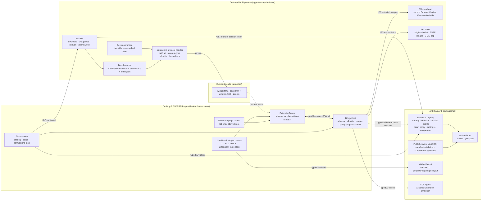
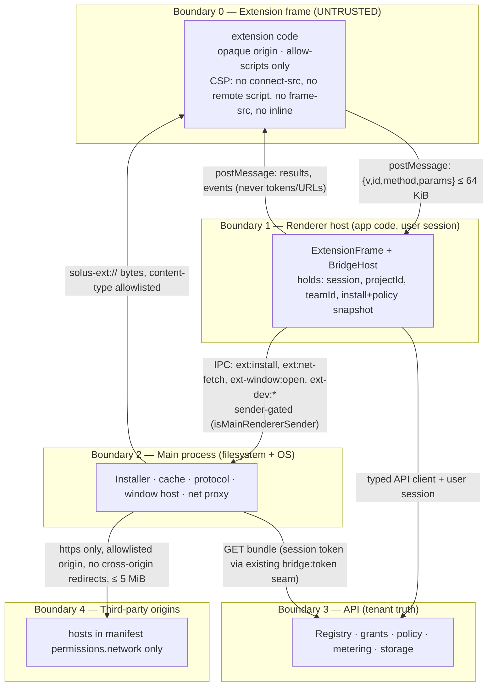

# Architecture — Extensions runtime (SOLUSDEV-235)

How an installed extension gets from the registry onto the user's screen, what it is allowed to
touch while it is there, and which process decides each of those things. Companion docs:
`DECISIONS.md` ADR-035 (the decision) and the ADR-034 amendment of 2026-09-03 (the cache layout),
`docs/contracts/extension-manifest.md` (the one file a bundle carries), `docs/contracts/widget.md`
(CTR-01 slots the canvas is made of), `docs/contracts/focus.md` (the shared focus the bridge
exposes), `docs/wireflows/store.md` + `docs/wireflows/extensions-runtime.md` +
`docs/wireflows/widget-canvas.md` (what the user sees), `docs/api/API.md` §2.17 (routes — the
authority for every path named here).

## 1. Purpose

Extensions are versioned bundles anyone may publish (ADR-035 §5). They render inside the desktop
app, beside the user's session and the team's proprietary designs, so CLAUDE.md §7 applies to them
the way it applies to a third-party MCP server: the code is untrusted, and the invariants have to be
**mechanical, not reviewed**. This document pins the mechanism:

- **Where extension code runs**: a sandboxed `<iframe>` served from a read-only custom protocol,
  with no network, no Node, no preload, and an opaque origin. Never anywhere else.
- **What it can reach**: only a closed, host-owned `postMessage` method set, each method tied to one
  manifest scope, executed by the host with the **user's** session and the **host's** project scope.
- **Who decides**: the desktop MAIN process owns bytes on disk and the protocol; the renderer host
  owns the bridge; the API owns the truth about what is installed, granted, blocked, and metered.

If a piece of extension-related code does not fit one of those three owners, it is in the wrong
place.

## 2. Component map



Ownership, one line each:

| Component        | Process  | Owns                                                                                                                                                                   |
| ---------------- | -------- | ---------------------------------------------------------------------------------------------------------------------------------------------------------------------- |
| Registry         | API      | What exists, what each project has installed at which pinned version, grants, team blocks, project defaults, per-project settings values, `storage.own` blobs          |
| Review job       | API      | Turning an uploaded bundle into a visible version: manifest validation, bundle ≤ 25 MiB, per-asset caps, disallowed asset types rejected, sha256 recorded              |
| ArtifactStore    | API      | Bundle bytes; the same path SOL artifacts already ride (ADR-035 §5)                                                                                                    |
| Installer        | main     | Downloading a version, guarding the archive, verifying its hash, writing the cache atomically, maintaining `index.json`                                                |
| Bundle cache     | main     | `~/.solus/extensions/` — the only place `solus-ext://` may read from                                                                                                   |
| Protocol handler | main     | Mapping `solus-ext://<id>/<version>/<path>` to a cached file, or 404                                                                                                   |
| Window host      | main     | Creating the second `BrowserWindow` for a window view, sizing it from the manifest, guarding its navigation                                                            |
| Net proxy        | main     | The only code that talks to a non-Solus host on an extension's behalf                                                                                                  |
| Developer mode   | main     | Registering an unpacked folder as `dev:<id>` and serving it through the same protocol                                                                                  |
| ExtensionFrame   | renderer | The `<iframe>` element, its `sandbox`/`src`, the `loading → ready → error` state machine, the fade-in                                                                  |
| BridgeHost       | renderer | Every message in or out of a frame: validation, method allowlist, scope check, policy snapshot check, limits, the real call, event fan-out, refusal events             |
| Page screen      | renderer | `MainScreen 'ext-page'`: rail entry, header, one ExtensionFrame in `page` mode                                                                                         |
| Widget canvas    | renderer | Live Bench slot grid; built-in CTR-01 widgets render directly, extension widgets through ExtensionFrame in `widget` mode; layout saved server-side per (project, user) |
| Store            | renderer | Catalog, detail, install/uninstall/enable, the permissions step, update flow (`docs/wireflows/store.md`)                                                               |

## 3. Trust boundaries



What crosses each boundary, and what never does:

| Boundary            | Crosses                                                                                                                                                                              | Never crosses                                                                                                                                                                                 |
| ------------------- | ------------------------------------------------------------------------------------------------------------------------------------------------------------------------------------ | --------------------------------------------------------------------------------------------------------------------------------------------------------------------------------------------- |
| 0 → 1 (frame→host)  | JSON requests `{ v, id, method, params }` ≤ 64 KiB; `ui.ready`                                                                                                                       | Project or team ids as scope (the host's own scope is used; a `projectId` in `params` is rejected as `invalid_params`), DOM access (opaque origin), navigation of the host                    |
| 1 → 0 (host→frame)  | Responses, events, the `init` payload (settings values, theme css-var values, current focus, projectId as an opaque display id)                                                      | Supabase tokens, the API base URL, any header, team member data not requested through a scoped method, other extensions' data, raw HTML                                                       |
| 1 → 2 (host→main)   | Install/remove requests by `{ id, version }`; net-fetch requests by `{ extensionId, url, method, headers, body }`; window open by `{ extensionId }`; dev-mode register/reload/remove | File paths chosen by the renderer (main derives every path from validated `id`/`version`), the manifest's network allowlist (main re-reads it from the cached manifest, not from the message) |
| 2 → 0 (main→frame)  | Static bytes of the bundle over `solus-ext://`, with an allowlisted `Content-Type` and the frame CSP header                                                                          | Anything outside `~/.solus/extensions/<id>/<version>/` (or the registered dev folder), symlink targets, executed output of any kind                                                           |
| 1/2 → 3 (app→API)   | Registry reads, install/grant/settings/storage mutations, `sol.ask` with `X-Solus-Extension: <id>`, layout PUTs, data-collection events                                              | Anything on the frame's behalf that the user themself could not do (tools run with the user's permissions, §7)                                                                                |
| 2 → 4 (main→origin) | One https request to an origin listed in the manifest; response ≤ 5 MiB returned as text/base64                                                                                      | Cookies or Solus credentials of any kind; redirects to a different origin; requests to private, loopback, link-local or cloud-metadata ranges; non-https schemes                              |

Two properties make this hold without review:

1. **Scope comes from the host, never the message.** BridgeHost is mounted with the open project's
   id and the team's id, exactly as `EntityRef.projectId` travels with focus (`focus.md`). A request
   cannot name a project. This is the same property the change-signal spine relies on for untrusted
   producers (`change-signal-spine.md`): the worst a forged request achieves is a refused call
   against the scope it already has.
2. **The frame's origin is opaque.** `sandbox="allow-scripts"` without `allow-same-origin` gives the
   document a `null` origin. Consequences the host code must honour: outbound `postMessage` uses
   target origin `'*'` (there is no origin to name) — which is WHY nothing sensitive may ever be in
   an outbound message; inbound messages are accepted only when `event.source === frame.contentWindow`
   for a frame this host mounted, and `event.origin === 'null'`. Anything else is dropped silently.

## 4. Install lifecycle

```mermaid
sequenceDiagram
  autonumber
  participant U as User
  participant S as Store (renderer)
  participant A as API registry
  participant M as Main installer
  participant P as solus-ext:// handler
  participant F as ExtensionFrame

  U->>S: Install <name>
  S->>A: GET /extensions/{id}/versions (approved versions: manifest, content_hash, bundle_size_bytes)
  S->>U: Permissions step: scopes · network origins · privacy policy link
  U->>S: Grant and install
  S->>A: PUT /projects/{project_id}/extensions/{id} { version, granted_scopes, granted_network } → 201
  A-->>S: install row { version, enabled, granted_scopes, granted_network }
  S->>A: GET /extensions/{id}/versions/{version}/bundle (zip ≤ 25 MiB; X-Solus-Content-Hash)
  S->>M: IPC ext:install { id, version, contentHash: <from the install row>, bytes }
  M->>M: sha256(bytes) == contentHash, else nothing is written (main has no API session of its own)
  M->>M: zip guards → extract into ~/.solus/extensions/.tmp/<id>-<version>-<nonce>/
  M->>M: rename tmp → ~/.solus/extensions/<id>/<version>/ (atomic, 0700 dirs / 0600 files)
  M->>M: index.json ← { id, version, sha256, files: { path: sha256 }, installed_at } (atomic temp+rename)
  M-->>S: { ok: true } (or { ok: false, code })
  S->>F: mount ExtensionFrame src=solus-ext://<id>/<version>/<entry>
  F->>P: GET <entry>, then assets
  P->>P: validate id/version · resolve inside cache root · verify file sha256 on first serve · allowlisted content-type
  P-->>F: bytes + CSP header
  F->>S: load → host posts init → frame posts ui.ready → fade in
```

Rules the sequence encodes:

- **The server is the source of truth for what is installed.** A cache entry without an install row
  is garbage (main sweeps it at launch); an install row without a cache entry is a download that
  has not happened yet (the frame shows `loading` and the installer runs). Deleting
  `~/.solus/extensions/` loses nothing but time.
- **Hash verification happens in main against the server's `content_hash`.** As shipped
  (SOLUSDEV-235 EXT-05/EXT-13): the renderer — which holds the user's session; main has no API
  client — fetches the bundle and passes `{ id, version, contentHash, bytes }` over IPC, where
  `contentHash` is the value from the server's install/version row. Main refuses to write anything
  unless `sha256(bytes) === contentHash` and the bundle's own `extension.toml` names the same
  id/version. A compromised renderer could therefore present a self-consistent hash+bytes pair; the
  protective boundary against that is the sandboxed frame and the bridge (§3, §6), not the cache
  write. Moving the fetch into main behind its own session is a follow-up if that residual is judged
  unacceptable.
- **The archive is treated like any upload (§7)**: entry count cap (2,000), per-entry expanded cap
  (bundle-level caps from `MANIFEST_LIMITS`), total expanded ≤ 25 MiB (zip-bomb guard), entry names
  must be relative, traversal-free, backslash-free, no symlinks, no absolute paths, suffix in the
  served-content-type allowlist below or `.toml` for the manifest. Any violation aborts the install
  and removes the temp directory; nothing partial ever lands under `<id>/<version>/`.
- **The manifest inside the archive is parsed by main** (`parseExtensionManifest` on the decoded
  TOML) and must agree with the registry's `id` and `version`; a mismatch is a failed install
  (`manifest_mismatch`), not a warning.
- **`index.json` (schema_version 1)** is the only file main writes outside a version directory:

  ```json
  {
    "schema_version": 1,
    "installed": [
      {
        "id": "bom",
        "version": "1.2.0",
        "sha256": "<archive sha256>",
        "files": { "widget.html": "<sha256>", "widget.js": "<sha256>" },
        "installed_at": "2026-09-03T10:00:00Z"
      }
    ]
  }
  ```

  Written atomically (temp + rename, the `localState.ts` pattern), 0600. A newer `schema_version`
  is read-only (never rewritten), the same rule `projects.json` follows. Format changes amend
  ADR-034 and ADR-035 together.

- **Two versions may coexist on disk** (the pinned one and a just-downloaded update) until the
  user's explicit Update swaps the install row; main then removes the superseded directory. Updates
  are never automatic (ADR-035 §5).
- **Uninstall** deletes the server row first, then main removes `<id>/<version>/` and the index
  entry; frames for that extension unmount on the row's disappearance from the snapshot, not on the
  file deletion.

## 5. The `solus-ext://` protocol

Registered in main before `app.whenReady()` as a privileged scheme
(`standard: true, secure: true, supportFetchAPI: false, corsEnabled: false, stream: true`) and
handled with `protocol.handle('solus-ext', …)` after ready. The renderer's own CSP gains
`frame-src solus-ext:` and nothing else changes for it.

Request resolution, in order — the first failure returns 404 with an empty body (no reason text
leaves main; the reason is logged with the requested URL):

1. `host` segment (`<id>`) matches `^[a-z][a-z0-9-]{1,63}$` and is not `__proto__`, `constructor`,
   `prototype`.
2. First path segment (`<version>`) is valid semver **or** the literal `dev` when a developer
   registration for `<id>` exists (§7). Nothing else.
3. `<id>` + `<version>` is present in `index.json` (or is the dev registration).
4. Remaining path decodes (`decodeURIComponent`) to relative segments matching `[A-Za-z0-9_.-]+`
   with no `.`/`..` segments, no backslash, ≤ 200 chars per segment, ≤ 16 segments.
5. `realpath` of the joined path starts with `realpath(<cache root>/<id>/<version>/)` and the entry
   is a regular file (symlinks anywhere in the chain → 404).
6. Suffix is in the allowlist; response `Content-Type` is fixed by suffix, never sniffed:

   | suffix   | content-type               |
   | -------- | -------------------------- |
   | `.html`  | `text/html; charset=utf-8` |
   | `.js`    | `text/javascript`          |
   | `.css`   | `text/css`                 |
   | `.json`  | `application/json`         |
   | `.svg`   | `image/svg+xml`            |
   | `.png`   | `image/png`                |
   | `.webp`  | `image/webp`               |
   | `.woff2` | `font/woff2`               |
   | `.md`    | `text/markdown`            |

7. On the first serve of a file in this app session its sha256 is compared with `index.json`; a
   mismatch → 404, the cache entry is marked `corrupt`, and the installer re-downloads. Dev
   registrations skip this step (there is no recorded hash) and are served with
   `Cache-Control: no-store`.

Every `.html` response carries the frame CSP header:

```
Content-Security-Policy: default-src 'none'; script-src 'self'; style-src 'self';
  img-src 'self' data:; font-src 'self'; connect-src 'none'; frame-src 'none';
  object-src 'none'; base-uri 'none'; form-action 'none'; navigate-to 'none'
```

`'self'` resolves to `solus-ext://<id>` — the bundle's own files and nothing remote. No
`'unsafe-inline'`, so a bundle must ship `<script src>` / `<link rel=stylesheet>` (the
`panel_assets.py` precedent: split assets so the policy needs no hashes). Main never executes,
evaluates, transforms or templates a bundle file; it streams bytes.

## 6. Bridge protocol (renderer host ↔ frame)

All messages are JSON via `postMessage`. `v` is always `1`; anything else is dropped.

### 6.1 Message shapes

```ts
// frame → host
{ v: 1, id: string, method: string, params: object }

// host → frame (exactly one per request id)
{ v: 1, id: string, ok: true,  result: unknown }
{ v: 1, id: string, ok: false, error: { code: ErrorCode, message: string } }

// host → frame (unsolicited)
{ v: 1, event: string, data: unknown }
```

`id` is chosen by the frame (≤ 64 chars, `[A-Za-z0-9_-]`), must be unique among in-flight requests,
and is echoed verbatim. A duplicate in-flight `id` is `invalid_params`.

### 6.2 Handshake and states

| ExtensionFrame state | Entered when                                                                                    | Shown as                                    |
| -------------------- | ----------------------------------------------------------------------------------------------- | ------------------------------------------- |
| `loading`            | Frame mounted; bundle may still be downloading                                                  | Skeleton in the slot / screen               |
| `ready`              | Frame `load` fired → host posted `init` → frame answered `ui.ready`                             | Frame fades in (`.screen-in` timing)        |
| `error`              | `ui.ready` not received within 10 s, protocol 404 on the entry, install failed, or policy block | Error card with the reason and actions (§8) |

`init` payload (the one message a frame can rely on before making any request):

```ts
{
  v: 1, event: 'init',
  data: {
    extensionId: string,
    version: string,           // semver, or 'dev'
    projectId: string,         // display/cache key only; NOT accepted back as scope
    settings: Record<string, boolean | number | string>,   // the extension's own declared fields
    theme: Record<string, string>,                          // current values of the app's CSS variables (--bg, --tx, --acc, …)
    focus: Focus | null,                                    // docs/contracts/focus.md shape
    mode: 'widget' | 'page' | 'window' | 'dev'
  }
}
```

`mode: 'dev'` is reported for any dev registration regardless of view kind so a bundle can show
its own developer affordances; the host's DEV badge does not depend on the bundle honouring it.

### 6.3 Method → scope table (closed; lives in host code, not configuration)

| method                  | required scope                 | params (validated)                                              | result                                                                                                    |
| ----------------------- | ------------------------------ | --------------------------------------------------------------- | --------------------------------------------------------------------------------------------------------- |
| `ui.ready`              | —                              | `{}`                                                            | `{}` — completes the handshake                                                                            |
| `settings.get`          | — (own values only)            | `{}`                                                            | `Record<key, value>` for the manifest's declared fields                                                   |
| `ui.openExternal`       | —                              | `{ url: https URL }`                                            | `{}` — via main's `externalUrl` guard; non-https → `invalid_params`                                       |
| `graph.getFocus`        | `graph.read`                   | `{}`                                                            | entity for the current focus, or `null`                                                                   |
| `graph.getEntity`       | `graph.read`                   | `{ entityId }`                                                  | entity (host-scoped project)                                                                              |
| `graph.getNeighborhood` | `graph.read`                   | `{ entityId, depth ≤ 2, limit ≤ 200 }`                          | `{ entities[], relations[] }`                                                                             |
| `graph.search`          | `graph.read`                   | `{ q ≤ 200 chars, types?, limit ≤ 50 }`                         | `entities[]`                                                                                              |
| `telemetry.subscribe`   | `telemetry.read`               | `{ signalIds ≤ 32 }`                                            | `{ subscriptionId }`; samples arrive as `telemetry.sample` events                                         |
| `telemetry.unsubscribe` | `telemetry.read`               | `{ subscriptionId }`                                            | `{}`                                                                                                      |
| `sources.list`          | `sources.read`                 | `{}`                                                            | `[{ id, kind, name, status, lastSyncAt }]` — no credentials, no URLs with tokens                          |
| `findings.create`       | `findings.write`               | `{ title ≤ 120, body ≤ 4 KiB, severity, entityIds ≤ 16 }`       | `{ findingId }` — body stored as text, rendered as text                                                   |
| `sol.ask`               | `sol.ask`                      | `{ prompt ≤ 8 KiB, entityIds ≤ 16 }`                            | `{ answer: string }` — see §6.6                                                                           |
| `storage.get`           | `storage.own`                  | `{ key ≤ 64 }`                                                  | `{ value: string \| null }`                                                                               |
| `storage.set`           | `storage.own`                  | `{ key ≤ 64, value ≤ 64 KiB }`                                  | `{}`; total per (project, extension) ≤ 256 KiB → `storage_quota`                                          |
| `storage.delete`        | `storage.own`                  | `{ key }`                                                       | `{}`                                                                                                      |
| `focus.get`             | `focus.read`                   | `{}`                                                            | `Focus \| null`                                                                                           |
| `focus.propose`         | `focus.write`                  | `{ entityId, domain, label?, relation? }`                       | `{ accepted: boolean }` — the host arbitrates via `descend()`; a cross-project entity is `invalid_params` |
| `net.fetch`             | origin ∈ `permissions.network` | `{ url, method ∈ GET/POST/PUT/DELETE, headers?, body ≤ 1 MiB }` | `{ status, headers (allowlisted), body, encoding: 'text' \| 'base64' }` — see §6.5                        |

Anything not in this table is `unknown_method`. Adding a method is a change to this document and
to the host's allowlist in the same MR; adding a **scope** is a contract change (tier-2,
`extension-manifest.md`).

### 6.4 Error codes

| code             | when                                                                                                            |
| ---------------- | --------------------------------------------------------------------------------------------------------------- |
| `unknown_method` | method not in §6.3                                                                                              |
| `scope_denied`   | method requires a scope the manifest does not declare OR the user has not granted for this project              |
| `invalid_params` | schema validation failed, including any attempt to pass a project/team id, an over-cap string, a duplicate `id` |
| `rate_limited`   | more than 60 requests in a rolling 10 s window, or more than 8 in flight, per extension per frame set           |
| `network_denied` | `net.fetch` target not in the manifest's origin list, not https, or resolved to a blocked range                 |
| `blocked`        | the install+policy snapshot says: not installed, disabled in this project, or blocked team-wide                 |
| `storage_quota`  | `storage.set` would exceed 256 KiB for this (project, extension)                                                |
| `unavailable`    | the host is offline or the API call failed; `message` is generic and never echoes a server body                 |
| `internal`       | host-side fault; logged with context, generic message to the frame                                              |

Messages are short, fixed strings owned by the host. They never include server error bodies, stack
traces, URLs, or ids the frame did not already have. **Every refusal** (`unknown_method`,
`scope_denied`, `invalid_params`, `rate_limited`, `network_denied`, `blocked`, `storage_quota`)
emits a data-collection event `extension.bridge_refused { extensionId, version, method, code }`.

### 6.5 Limits and drops

- Inbound message > 64 KiB, non-object, `v !== 1`, missing/oversized `id`, or from an unknown
  `source` → **dropped without a response** (no error is sent; a refusal would itself be an
  oracle). Dropped messages are counted per frame and surfaced in the DEV badge tooltip for dev
  registrations only.
- Rate limit: 60 requests / rolling 10 s and 8 in flight, counted per extension across all of its
  mounted frames in this renderer (a widget + a page share the budget). Exceeding either →
  `rate_limited`; the limiter itself is not rate limited.
- `net.fetch`, performed by MAIN on IPC from BridgeHost: https only; the target origin is checked
  by main against the **cached manifest's** `permissions.network` (renderer-supplied allowlists
  are ignored); DNS results in private (10/8, 172.16/12, 192.168/16), loopback, link-local
  (169.254/16 including `169.254.169.254`), CGNAT (100.64/10), `0.0.0.0/8`, and IPv6 equivalents
  (`::1`, `fc00::/7`, `fe80::/10`) are refused; redirects are followed manually up to 3 hops and
  only while the origin is unchanged; request body ≤ 1 MiB; response body ≤ 5 MiB (aborted past
  the cap → `network_denied` with message "response too large"); 30 s timeout; no cookie jar; the
  host adds **no** headers of its own beyond `User-Agent: Solus-Extension/<id>`; the extension may
  set its own headers except `Cookie`, `Host`, `Origin`, `Referer`. Responses are returned as text
  when the content-type is textual, else base64.
- Per frame, at most 8 telemetry subscriptions and 32 signals each; samples are batched to the
  frame at ≤ 10 events/s (`telemetry.sample { subscriptionId, samples[] }`).

### 6.6 `sol.ask` attribution and metering

The host performs the real call through the typed API client with the user's session and adds
`X-Solus-Extension: <id>` (and `X-Solus-Extension-Version: <version>`). The server: verifies the
extension is installed and enabled in the request's project and that `sol.ask` is granted; meters
the turn to the **invoking user's** budget (ADR-017/018/019) with the extension id as the credit
attribution; applies the same loop guards, rate limits and per-team caps as any SOL turn. The
extension's `prompt` is wrapped as data inside Solus's own system instructions (§7 instruction/data
separation) — an extension can ask a question, never issue an instruction. The `answer` returned
to the frame is text; the frame renders it however it likes inside its own sandbox, and the host
never renders it.

### 6.7 Events (host → frame)

| event              | data                                                    | when                                                                               |
| ------------------ | ------------------------------------------------------- | ---------------------------------------------------------------------------------- |
| `init`             | §6.2                                                    | once, after the frame's `load`                                                     |
| `focus.changed`    | `Focus \| null`                                         | the shared focus store notified (only to frames with `focus.read` or `graph.read`) |
| `settings.changed` | `Record<key, value>`                                    | the user saved this extension's Settings tab                                       |
| `theme.changed`    | `Record<cssVar, value>`                                 | the app theme (or system appearance) changed                                       |
| `project.changed`  | `{ projectId }`                                         | the host's project changed; frames are also remounted — treat as a full reset      |
| `telemetry.sample` | `{ subscriptionId, samples: [{ signalId, t, value }] }` | while a subscription is live                                                       |

Events are not acknowledged. A frame that has not completed `ui.ready` receives only `init`.

### 6.8 Team policy at call time

BridgeHost holds an **install+policy snapshot** for the open project: `{ installs: { [id]: {
version, enabled, grants[] } }, blocked: id[], fetchedAt }`, from `GET
/projects/{project_id}/extensions`. It is refreshed on project open, after every Store mutation,
on an `extension.*` SSE event for the project, and at most every 60 s otherwise. Every bridge call
checks the snapshot first (`blocked` if missing/disabled/blocked). When a refresh removes or blocks
an extension, its frames unmount immediately and the slot/screen shows the `blocked` state
(`docs/wireflows/extensions-runtime.md`). The server enforces the same rules independently on
every attributed call (`sol.ask`, `findings.create`, `storage.*`, grants), so a stale snapshot can
only refuse, never over-permit.

## 7. Developer mode

- Entry: Settings → Developer → "Load unpacked extension…" (renderer) → IPC `ext-dev:register`
  → main opens the OS folder picker. Main refuses `~`, `~/.solus`, any filesystem root, and any
  path under `~/.solus/extensions/` (a dev registration must never alias the cache), with a fixed
  reason string.
- Main reads `<folder>/extension.toml`, decodes TOML, runs `parseExtensionManifest`; `{ ok: false }`
  returns the dotted-path `problems[]` verbatim to the renderer and registers nothing. `newer` is
  reported as such (the desktop treats a newer schema as read-only: shown, not loaded).
- Success registers `dev:<id>` in main's session-held table `{ id, path, manifest }`; the bundle is
  served at `solus-ext://<id>/dev/<entry>` through the same handler (§5 step 2), `no-store`, and
  with the same path jail rooted at the registered folder's `realpath`.
- The renderer lists dev registrations beside installed extensions everywhere an extension can
  appear (rail page entry, widget picker, window), always with the DEV badge and `mode: 'dev'`.
- **Grants**: a dev registration has no install row. At load the same permissions step is shown;
  the resulting grants live only in the renderer for this session and are never written to the
  server and never merged with a published extension's grant row, even for the same `id`. If a
  published extension with the same `id` is installed in the project, both appear, labelled.
- **Never publishable** from the desktop: publishing is a registry action from the developer's
  account, and the desktop offers no button for it.
- **Reload** re-reads and re-validates the manifest, then remounts every frame of `dev:<id>` with a
  fresh cache-busting nonce (`?r=<n>`, ignored by the handler). **Remove** drops the registration
  and unmounts its frames.
- Registrations are session-only in this build (§10, open question 1).

## 8. Failure modes and what the user sees

| Failure                                              | Detected by                        | User sees                                                                                                                                   |
| ---------------------------------------------------- | ---------------------------------- | ------------------------------------------------------------------------------------------------------------------------------------------- |
| Bundle download fails / offline                      | main installer                     | Slot or screen in `loading` with "Downloading <name>…", then error "Couldn't download <name>. Retry" — the install row stays; retry is free |
| Hash mismatch on download                            | main installer                     | "The downloaded bundle didn't match the registry. Retry" — temp dir removed; event `extension.install_failed { code: 'hash_mismatch' }`     |
| Zip guard violation / manifest mismatch              | main installer                     | "This version's bundle was rejected. Report it" (link to the extension's issues URL, https only)                                            |
| Cached file hash mismatch at serve                   | protocol handler                   | Frame shows error "Extension files changed on disk. Reinstalling…" and the installer re-downloads                                           |
| Entry 404 (bad manifest entry, missing file)         | ExtensionFrame (`load` error/10 s) | "<name> didn't start." with **Reload** and, for dev, the request path that 404'd                                                            |
| `ui.ready` timeout                                   | ExtensionFrame                     | Same as above; the frame stays mounted but hidden so a slow bundle can still recover on Reload                                              |
| Extension throws inside its own frame                | not visible to host                | Nothing — the sandbox contains it; the frame remains `ready`. Dev registrations may open DevTools on the frame                              |
| Bridge refusal (`scope_denied`, `unknown_method`, …) | BridgeHost                         | Nothing in Solus chrome (the extension gets the error and decides); dev registrations show a counter in the DEV badge tooltip               |
| Rate limited                                         | BridgeHost                         | Extension-side only; a persistently limited extension is visible in the Store detail "IN THIS PROJECT" card once metering exists            |
| Team owner blocks the extension                      | snapshot refresh                   | Frames unmount; slot/screen shows "Blocked by your team" with **Remove from layout**; Store shows `BLOCKED`                                 |
| Version update widens scopes                         | Store update flow                  | Update is not applied until the user re-grants in the permissions step                                                                      |
| Project switch                                       | shell                              | All frames remount; canvas loads the new project's layout; window views receive `project.changed`, then remount                             |
| Offline, layout PUT fails                            | canvas                             | Layout applied locally, note "Layout not saved — offline"; retried on reconnect                                                             |
| Window view renderer dies                            | main (`render-process-gone`)       | The window closes (SOL window precedent, SEC-M2); the page/widget in the main window is unaffected                                          |
| Newer manifest `schema_version` in a dev folder      | main dev mode                      | Listed as "Needs a newer Solus" with the version; not loaded                                                                                |

Nothing above fabricates progress: `loading` means a download or handshake is genuinely in flight,
and every error names the step that failed.

## 9. Security checklist (CLAUDE.md §7)

| §7 rule                                              | How this design meets it                                                                                                                                                                                                                        |
| ---------------------------------------------------- | ----------------------------------------------------------------------------------------------------------------------------------------------------------------------------------------------------------------------------------------------- |
| No secrets in source, logs, or responses             | The frame never receives a token, base URL, or header (§3); `sources.list` strips credentials and tokenised URLs; main logs URLs of refused requests, never bodies or headers                                                                   |
| Integration credentials never returned by an API     | Same — and `net.fetch` carries no Solus credential, so an extension cannot relay one                                                                                                                                                            |
| Injection & input handling                           | Every bridge request is schema-validated (§6.3); protocol path resolution is a jail with realpath (§5); zip extraction has traversal, symlink, count and size guards (§4); no eval/exec of any bundle content in main or the renderer           |
| File uploads: type/size validated, never executed    | Publish review job caps the bundle and rejects disallowed asset types; main re-validates on install; the handler serves fixed content-types and never executes                                                                                  |
| Subprocess calls                                     | None. The runtime has no subprocess.                                                                                                                                                                                                            |
| Centralised auth, team scoping on every query        | The host performs every call with the user's session through the typed API client; scope is the host's, never the message's; the server re-verifies install, grant and policy on attributed calls (§6.6, §6.8)                                  |
| Cross-tenant isolation                               | `projectId` in params is rejected; the snapshot and every call are bound to the mounted project; `focus.propose` refuses cross-project entities (`descend()` throws); layout is per (project, user)                                             |
| WebSockets scoped at connect                         | Telemetry subscriptions are the host's existing per-project streams, fanned out to frames; a frame has no socket                                                                                                                                |
| Rate limiting on expensive endpoints                 | 60/10 s + 8 in flight per extension at the host; `sol.ask` under the user's budget and the team's cap server-side; refusals logged                                                                                                              |
| Telemetry ingestion treats device input as untrusted | Unchanged; frames see already-parsed samples                                                                                                                                                                                                    |
| Prompt injection: instruction/data separation        | `sol.ask` prompt is wrapped as data; extension-declared strings (name, labels, findings) are rendered as text (`textContent`), never markup; settings values are typed by the manifest                                                          |
| No ingested content alters auth, scope, tools, mode  | Method set and scopes are fixed in host code before any frame loads; the frame cannot select tools or change the mode                                                                                                                           |
| Model proposes, Solus decides                        | `sol.ask` returns text only; an extension cannot request a tool call; `findings.create` is a validated write the user could make themself                                                                                                       |
| Model/extension output untrusted before render/graph | `findings.create` body and titles stored and rendered as text; the host never `innerHTML`s anything from a frame; graph writes are limited to findings                                                                                          |
| Destructive actions need explicit confirmation       | The bridge has no destructive method. `ui.openExternal` opens the OS browser only for https via `externalUrl.ts`                                                                                                                                |
| Per-user/per-team limits, spend caps, loop guards    | `sol.ask` rides the SOL Agent's existing guards (ADR-017/018/019); attribution via `X-Solus-Extension`                                                                                                                                          |
| Tools run with the user's permissions                | The host's session IS the user's; there is no service credential in the desktop                                                                                                                                                                 |
| Context assembled fresh, team-scoped                 | `sol.ask` goes through the same SOL request path and context assembly as the SOL page                                                                                                                                                           |
| Credentials never enter model context                | Nothing from `~/.solus` or config reaches a prompt; extension settings are typed non-secret fields                                                                                                                                              |
| Red-team fixtures                                    | The bridge test suite includes a hostile bundle fixture (attempts `projectId` params, oversized messages, `../` paths, `javascript:` URLs, private-range `net.fetch`, `sol.ask` with injected instructions) and asserts every refusal and event |
| IPC sender gating                                    | `ext:*` and `ext-window:*` IPC handlers accept only the app's own renderer windows (`isFromWindow` / `isMainRendererSender`, the SOL window precedent SEC-M1)                                                                                   |

## 10. Open questions

1. **Persistence of developer registrations across app restarts.** This design keeps them
   session-only. Persisting them means a new block in `~/.solus/extensions/index.json` (or a
   `config.json` key), which is an ADR-034/035 format amendment — a human call. Recommendation:
   add `"dev": [{ id, path }]` to `index.json` in a follow-up, validated on read like everything
   else there.
2. **Server-attributed methods for dev registrations.** `sol.ask`, `findings.create` and `storage.*`
   require the server to verify an install row, which a dev registration does not have. This
   design refuses them with `blocked` for dev entries. If developers need to exercise them before
   publishing, the registry needs a "development install" concept (a per-user, per-project row
   flagged `dev`, never visible to teammates) — an API §2.17 addition to decide at the MR.
