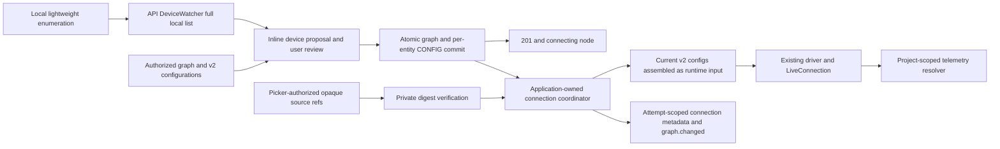

# Architecture — Physical hardware ownership and onboarding

**Last updated:** 2026-09-11. **Status:** integrated 251/250 architecture with explicitly
labeled later SOLUSDEV-253/256 targets,
extending R1–R5 (SOLUSDEV-248). Implementation status and measured results belong in each ticket's
completion report. Governing decisions: ADR-005/012/025/027/029/030/031 and ADR-034 amendment
2026-09-07. [Routes](../api/hardware.md), [wireflow](../wireflows/hardware-onboarding.md),
[storage/migration](../schemas/hardware-config.md), [local runner](local-connections.md),
[workspace](workspace-navigation.md), [private state](../contracts/local-state.md).

The same path handles a loose battery, bracket, controller, custom machine or detected robot.
Saving hardware creates project graph context without requiring a connection, calibration,
CAD, ROS or simulator. Identification produces evidence for review, never asserted ownership.
Vendors remain in plugins and definition data; the path between transport and graph is generic.

## Graph ownership and configuration

Every physical entity belongs to its project. A part may have no robot parent. Optional ownership
is a manual edge to a live manual robot/category, separate from provider containment and physical
connection/bus mappings. Do not invent a robot for a part, or arbitrary nesting for provider
assemblies. Assignment, detachment, reassignment and robot removal preserve part UUIDs,
configuration entry IDs, values, provenance, source identity, canonical links and coordinates.
Canvas dragging never changes ownership. Retained and new unassigned parts use the same query
and remain reachable even when a provider document is their presentation parent.

Each configured entity has at most one active `.solus` CONFIG entry. `EntityHardwareConfig`
schema 2 identifies `entity_id`; optional `component` holds that subject's calibration, limits,
telemetry, firmware and lifecycle. An optional identity/protocol/bus map belongs to the entity
providing the connection, including a controller/gateway part. There is no stored robot-level
copy of all mutable part configs. `configured_entity_id`, version and manual `configures` edge
provide indexed, validated subject lookup; only manual entities may carry a convenience
`hardware_config_ref` attribute. Provider-owned properties and external_ref are untouched.

The hardware runtime boundary assembles current referenced component configs into the existing
v1 driver input. Drivers retain their current protocol and do not learn storage, tenancy or
ownership rules. Multiple controllers use actual entities/configs. GET is read-only; deleting
a config does not recreate it on a later read. Expected-version writes, reviewed proposals and
operation idempotency protect concurrency. Graph/config/operation persistence is atomic and
commits before any optional connection; a failed connection leaves the saved node usable.

Provenance names every operational valued leaf. Plugin/library/repo/detected observations
remain evidence and cannot silently replace saved decisions. Ambiguous unit modes remain
unresolved; do not infer degrees from a conditional branch or assume position telemetry on every
part. Supported channels derive from capability evidence. Saved, connectable, session-open,
receiving actual packets and setup-required are distinct statuses.

## Identity, leases and telemetry

Stable identity is transport-specific, such as `usb:<serial>` or `can:<adapter-binding>`, never
a tty path or vendor/driver name. A part endpoint is `<device_ref>/<address>`. Stable refs are
optional at enumeration. Current serial-less devices use `usb:port-<location>` only when a
USB topology position exists. This identifies a port, not a board; moving it fails resolution,
and absent/ambiguous bindings cannot be proposed. Cards and sidebar explain “no serial number —
identity is tied to this USB port; keep it plugged in here”. The shared binding rule is
`recognition/passive.binding_key`. Opaque observation IDs and attachment generations are the
later 253/256 selection model; do not claim they are supplied by the current enumeration schema.
A prior local port hint is not durable reconnect permission. Reliable bindings are re-resolved
after unplug/replug; ambiguous endpoints need fresh user selection.

The approved later 253/256 lease design requires one runner-owned machine-wide lease for every open path: selected interrogation, raw
serial, active sessions and reconnect. An active session owns its port and is not interrupted by
background discovery. Another project sees only generic busy state. Probes have an overall
deadline and cooperative cancellation; cancellation closes/releases resources before a new
owner can open them. HTTP abort alone does not stop a blocking worker. Reconnect factory opens
run inside retry/error handling and re-resolve the current binding each attempt.

The existing project-scoped `EntityResolver.resolve(project_id, device_id)` resolves a unique
validated configuration binding, retaining legacy manual external_ref support. Never rewrite an
imported external_ref. Ambiguous live mappings resolve to no target/error instead of first-row
selection. Config/ownership/binding/deletion changes invalidate positive resolver caches. Packet
shape and `LiveConnection`/`PacketSource` interfaces stay unchanged; unclaimed signals remain
unresolved. A ping is not a live data packet or permission for motion.

## Local sources and reviewed proposals

MAIN stores picker-authorized paths/digests and connection hints only in the authenticated
project/account's private `~/.solus/projects/<projectId>/hardware.json`. The exact TS/Python
contract, limits, file modes and corruption/newer-version behavior are in local-state.md.
Shared `.solus` configuration contains portable source references and verified values. Neither
cloud API nor model context receives a local path; a remote repo_root is not read authority.
The local reader canonicalizes the authorized source and verifies bytes against its digest.
Missing/changed bytes require explicit relinking/review, not automatic calibration replacement.
Shared references are `source:<UUID>`; MAIN uses the bare UUID in the account/project private
store. Migrated references can be explicitly relinked through the native picker; selecting a
known file normally reuses its reference, while historical aliases remain valid. Relinking
changes private authorization only and preserves stored calibration values and provenance.
Non-null request `repo_root` is refused before filesystem access, even if a local registry is
missing. Parser/proposal expansion using verified source bytes remains later 253 work.

The local API's `DeviceWatcher` diffs lightweight detection at about 1 Hz only while
subscribed. It opens no ports and publishes full `hardware.devices_changed` lists with
`LiveHub.publish_local`; no device list travels through Redis or the companion. No local
runtime means no watcher. The desktop uses one scoped detected-device store for the canvas
rail and Add panel, discards obsolete generations, and never lets a delayed seed overwrite a
newer full frame. Unknown, board and protocol evidence remain distinct.

Current proposals use a bounded cache to avoid duplicate interrogation. Confirmation still
checks present-device identity; a cached proposal is not authority to bind an unplugged device.
The later generation/revision review design also requires current accepted-address, config,
source and ownership checks. Model suggestions remain evidence, not user names or accepted
config choices. Private file parsing and expanded review are not silently enabled by this merge.

## Save before asynchronous connection

The confirmation transaction saves independent v2 CONFIG entries and, when opening is requested,
`properties.connection` with `managed_by: local_runtime`, an API-owned `runtime_id`, an attempt
UUID and status `connecting`.
The response returns before driver opening. An application-owned coordinator uses fresh scoped
sessions, current configurations and the private-source reader; it validates attempt, ownership
and participating versions before opening and accepting completion. Terminal states are
`connected`, `failed` and `disconnected`; session UUIDs and portable errors accompany them where
appropriate. State changes use the existing project-scoped `graph.changed` hint.

Stale completion closes its session. Deletion cancels pending work and closes any associated
session, including acquisitions running in worker threads; shutdown drains the coordinator before
session manager/hub teardown. Startup resets only metadata matching this API's private persisted
runtime identity. A lifetime lock prevents another process using that identity concurrently.
Legacy/unidentified and foreign-runtime metadata remain untouched, as do hardware/configuration.
Saving never claims streaming: only received packets do.
Confirmation latency excludes background opening; correlated receipt/render and connection
measurements are reported separately, with overlap and replug cases included.

## Existing implementation seams

| Area                 | Existing entry points / responsibility                                                                                                                                               |
| -------------------- | ------------------------------------------------------------------------------------------------------------------------------------------------------------------------------------ |
| Transport            | `livebench/src/livebench/hardware/channel.py`, `usb_serial.py`, `usb_can.py`, `bluetooth.py`, `network.py`: port/channel operations behind the existing seam.                        |
| Registry and probing | `hardware/registries.py`, `driver.py`, `interrogator.py`, `detection.py`, `repo_config.py` under livebench: shared registries, enumeration, bounded parsing.                         |
| Plugins              | `livebench/src/livebench/plugins/`: vendor codecs, drivers, interrogators and config parsers; definitions and fixtures may contain vendor specifics.                                 |
| API state            | `packages/api/src/solus_api/hardware/config.py`, `store.py`, `detect.py`, `hardware_router.py`, `library_router.py`: project-scoped storage and reviewed operations.                 |
| Manual robots        | `packages/api/src/solus_api/services/physical_robots.py`: atomic real robot/category creation and retention on removal.                                                              |
| Runtime              | `packages/api/src/solus_api/livebench/sessions.py`, `livebench/src/livebench/local.py`, `hardware/connection.py`: runtime-optional loading, session ownership and config adaptation. |

These are actual existing files, not a mandate to create a parallel detection package. New
lease/ownership helpers extend these seams with exact file ownership in the execution plan.
`livebench` is loaded by the local API through `load_local`; the companion does not own ports,
telemetry never rides its MCP bridge, and cloud ARQ is not a local-device host. A cloud image
without the local runner returns honest unavailability. A future runner-host move preserves
these boundaries and requires its own documented decision.

## Migration, safety and proof

Separate schema/data revisions preflight all CONFIG history, including deleted owners,
duplicate subject configs, conflicting embedded part values, invalid references and private
paths. Preserve existing graph/robot-config IDs; extract independent part-config entries without
changing part IDs or provenance. Conflicting values are not enabled as limits/calibration.
Replace shared private paths with opaque references without reading legacy paths or guessing
their machine. Validate transformed state before enforcing uniqueness; fail an unrepresentable
v1 downgrade. Reassignment disables stale bindings until reviewed. See storage doc for exact
constraints and the 24-hour project/user operation ledger.

Interrogation allows declared passive/ping/listen actions only. Motion, flashing, deployment,
write-back and destructive changes retain concrete existing confirmation. Simulation is a
separate supported action and never proof of physical safety. No generated driver, per-device
container, OpenUSD or new simulator is part of this design. All device/document/model content is
untrusted; existing graph auth, prompt fencing, budgets and tool admission remain authoritative.

Verify tenant isolation, migration/idempotency races, source-safe imported binding, lease
contention/cancellation, typed recovery, capability honesty and stale scope rejection. Keep the
existing vendor-hygiene ratchets and three-machine fixture proof (recorded UDP/CAN/serial) green.
Record real Electron and available LeRobot tests separately from fixtures; unavailable ELEGOO
is not verified. Measure enumeration/proposal/confirmation/first-packet spans before choosing
optimizations, and do not infer runtime performance from unit test success.
