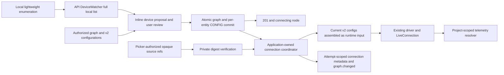

# Architecture — Physical hardware ownership and onboarding

**Last updated:** 2026-09-11. **Status:** integrated 251/250 architecture with explicitly
labeled later SOLUSDEV-253/256 targets,
extending R1–R5 (SOLUSDEV-248). Implementation status and measured results belong in each ticket's
completion report. Governing decisions: ADR-005/012/025/027/029/030/031 and ADR-034 amendment
2026-09-07. [Routes](../api/hardware.md), [wireflow](../wireflows/hardware-onboarding.md),
[storage/migration](../schemas/hardware-config.md), [local runner](local-connections.md),
[workspace](workspace-navigation.md), [private state](../contracts/local-state.md).

The same path handles a loose battery, bracket, controller, custom machine or detected robot.
Saving hardware creates project graph context without requiring a connection, calibration,
CAD, ROS or simulator. Identification produces evidence for review, never asserted ownership.
Vendors remain in plugins and definition data; the path between transport and graph is generic.

## Graph ownership and configuration

Every physical entity belongs to its project. A part may have no robot parent. Optional ownership
is a manual edge to a live manual robot/category, separate from provider containment and physical
connection/bus mappings. Do not invent a robot for a part, or arbitrary nesting for provider
assemblies. Assignment, detachment, reassignment and robot removal preserve part UUIDs,
configuration entry IDs, values, provenance, source identity, canonical links and coordinates.
Canvas dragging never changes ownership. Retained and new unassigned parts use the same query
and remain reachable even when a provider document is their presentation parent.

Each configured entity has at most one active `.solus` CONFIG entry. `EntityHardwareConfig`
schema 2 identifies `entity_id`; optional `component` holds that subject's calibration, limits,
telemetry, firmware and lifecycle. An optional identity/protocol/bus map belongs to the entity
providing the connection, including a controller/gateway part. There is no stored robot-level
copy of all mutable part configs. `configured_entity_id`, version and manual `configures` edge
provide indexed, validated subject lookup; only manual entities may carry a convenience
`hardware_config_ref` attribute. Provider-owned properties and external_ref are untouched.

The hardware runtime boundary assembles current referenced component configs into the existing
v1 driver input. Drivers retain their current protocol and do not learn storage, tenancy or
ownership rules. Multiple controllers use actual entities/configs. GET is read-only; deleting
a config does not recreate it on a later read. Expected-version writes, reviewed proposals and
operation idempotency protect concurrency. Graph/config/operation persistence is atomic and
commits before any optional connection; a failed connection leaves the saved node usable.

Provenance names every operational valued leaf. Plugin/library/repo/detected observations
remain evidence and cannot silently replace saved decisions. Ambiguous unit modes remain
unresolved; do not infer degrees from a conditional branch or assume position telemetry on every
part. Supported channels derive from capability evidence. Saved, connectable, session-open,
receiving actual packets and setup-required are distinct statuses.

## Identity, leases and telemetry

Stable identity is transport-specific, such as `usb:<serial>` or `can:<adapter-binding>`, never
a tty path or vendor/driver name. A part endpoint is `<device_ref>/<address>`. Stable refs are
optional at enumeration. Current serial-less devices use `usb:port-<location>` only when a
USB topology position exists. This identifies a port, not a board; moving it fails resolution,
and absent/ambiguous bindings cannot be proposed. Cards and sidebar explain “no serial number —
identity is tied to this USB port; keep it plugged in here”. The shared binding rule is
`recognition/passive.binding_key`. Opaque observation IDs and attachment generations are the
later 253/256 selection model; do not claim they are supplied by the current enumeration schema.
A prior local port hint is not durable reconnect permission. Reliable bindings are re-resolved
after unplug/replug; ambiguous endpoints need fresh user selection.

The approved later 253/256 lease design requires one runner-owned machine-wide lease for every open path: selected interrogation, raw
serial, active sessions and reconnect. An active session owns its port and is not interrupted by
background discovery. Another project sees only generic busy state. Probes have an overall
deadline and cooperative cancellation; cancellation closes/releases resources before a new
owner can open them. HTTP abort alone does not stop a blocking worker. Reconnect factory opens
run inside retry/error handling and re-resolve the current binding each attempt.

The existing project-scoped `EntityResolver.resolve(project_id, device_id)` resolves a unique
validated configuration binding, retaining legacy manual external_ref support. Never rewrite an
imported external_ref. Ambiguous live mappings resolve to no target/error instead of first-row
selection. Config/ownership/binding/deletion changes invalidate positive resolver caches. Packet
shape and `LiveConnection`/`PacketSource` interfaces stay unchanged; unclaimed signals remain
unresolved. A ping is not a live data packet or permission for motion.

## Local sources and reviewed proposals

MAIN stores picker-authorized paths/digests and connection hints only in the authenticated
project/account's private `~/.solus/projects/<projectId>/hardware.json`. The exact TS/Python
contract, limits, file modes and corruption/newer-version behavior are in local-state.md.
Shared `.solus` configuration contains portable source references and verified values. Neither
cloud API nor model context receives a local path; a remote repo_root is not read authority.
The local reader canonicalizes the authorized source and verifies bytes against its digest.
Missing/changed bytes require explicit relinking/review, not automatic calibration replacement.
Shared references are `source:<UUID>`; MAIN uses the bare UUID in the account/project private
store. Migrated references can be explicitly relinked through the native picker; selecting a
known file normally reuses its reference, while historical aliases remain valid. Relinking
changes private authorization only and preserves stored calibration values and provenance.
Non-null request `repo_root` is refused before filesystem access, even if a local registry is
missing. Parser/proposal expansion using verified source bytes remains later 253 work.

The local API's `DeviceWatcher` diffs lightweight detection at about 1 Hz only while
subscribed. It opens no ports and publishes full `hardware.devices_changed` lists with
`LiveHub.publish_local`; no device list travels through Redis or the companion. No local
runtime means no watcher. The desktop uses one scoped detected-device store for the canvas
rail and Add panel, discards obsolete generations, and never lets a delayed seed overwrite a
newer full frame. Unknown, board and protocol evidence remain distinct.

Current proposals use a bounded cache to avoid duplicate interrogation. Confirmation still
checks present-device identity; a cached proposal is not authority to bind an unplugged device.
The later generation/revision review design also requires current accepted-address, config,
source and ownership checks. Model suggestions remain evidence, not user names or accepted
config choices. Private file parsing and expanded review are not silently enabled by this merge.

## Save before asynchronous connection

The confirmation transaction saves independent v2 CONFIG entries and, when opening is requested,
`properties.connection` with `managed_by: local_runtime`, an API-owned `runtime_id`, an attempt
UUID and status `connecting`.
The response returns before driver opening. An application-owned coordinator uses fresh scoped
sessions, current configurations and the private-source reader; it validates attempt, ownership
and participating versions before opening and accepting completion. Terminal states are
`connected`, `failed` and `disconnected`; session UUIDs and portable errors accompany them where
appropriate. State changes use the existing project-scoped `graph.changed` hint.

Stale completion closes its session. Deletion cancels pending work and closes any associated
session, including acquisitions running in worker threads; shutdown drains the coordinator before
session manager/hub teardown. Startup resets only metadata matching this API's private persisted
runtime identity. A lifetime lock prevents another process using that identity concurrently.
Legacy/unidentified and foreign-runtime metadata remain untouched, as do hardware/configuration.
Saving never claims streaming: only received packets do.
Confirmation latency excludes background opening; correlated receipt/render and connection
measurements are reported separately, with overlap and replug cases included.

## Existing implementation seams

| Area                 | Existing entry points / responsibility                                                                                                                                               |
| -------------------- | ------------------------------------------------------------------------------------------------------------------------------------------------------------------------------------ |
| Transport            | `livebench/src/livebench/hardware/channel.py`, `usb_serial.py`, `usb_can.py`, `bluetooth.py`, `network.py`: port/channel operations behind the existing seam.                        |
| Registry and probing | `hardware/registries.py`, `driver.py`, `interrogator.py`, `detection.py`, `repo_config.py` under livebench: shared registries, enumeration, bounded parsing.                         |
| Plugins              | `livebench/src/livebench/plugins/`: vendor codecs, drivers, interrogators and config parsers; definitions and fixtures may contain vendor specifics.                                 |
| API state            | `packages/api/src/solus_api/hardware/config.py`, `store.py`, `detect.py`, `hardware_router.py`, `library_router.py`: project-scoped storage and reviewed operations.                 |
| Manual robots        | `packages/api/src/solus_api/services/physical_robots.py`: atomic real robot/category creation and retention on removal.                                                              |
| Runtime              | `packages/api/src/solus_api/livebench/sessions.py`, `livebench/src/livebench/local.py`, `hardware/connection.py`: runtime-optional loading, session ownership and config adaptation. |

These are actual existing files, not a mandate to create a parallel detection package. New
lease/ownership helpers extend these seams with exact file ownership in the execution plan.
`livebench` is loaded by the local API through `load_local`; the companion does not own ports,
telemetry never rides its MCP bridge, and cloud ARQ is not a local-device host. A cloud image
without the local runner returns honest unavailability. A future runner-host move preserves
these boundaries and requires its own documented decision.

## Migration, safety and proof

Separate schema/data revisions preflight all CONFIG history, including deleted owners,
duplicate subject configs, conflicting embedded part values, invalid references and private
paths. Preserve existing graph/robot-config IDs; extract independent part-config entries without
changing part IDs or provenance. Conflicting values are not enabled as limits/calibration.
Replace shared private paths with opaque references without reading legacy paths or guessing
their machine. Validate transformed state before enforcing uniqueness; fail an unrepresentable
v1 downgrade. Reassignment disables stale bindings until reviewed. See storage doc for exact
constraints and the 24-hour project/user operation ledger.

Interrogation allows declared passive/ping/listen actions only. Motion, flashing, deployment,
write-back and destructive changes retain concrete existing confirmation. Simulation is a
separate supported action and never proof of physical safety. No generated driver, per-device
container, OpenUSD or new simulator is part of this design. All device/document/model content is
untrusted; existing graph auth, prompt fencing, budgets and tool admission remain authoritative.

Verify tenant isolation, migration/idempotency races, source-safe imported binding, lease
contention/cancellation, typed recovery, capability honesty and stale scope rejection. Keep the
existing vendor-hygiene ratchets and three-machine fixture proof (recorded UDP/CAN/serial) green.
Record real Electron and available LeRobot tests separately from fixtures; unavailable ELEGOO
is not verified. Measure enumeration/proposal/confirmation/first-packet spans before choosing
optimizations, and do not infer runtime performance from unit test success.

## SOLUSDEV-262 — brain topology amendment (implementation in progress)

The user-approved brain-centric brief supersedes the category presentation above. A robot is
presented as brains → buses → devices → parts. A controller on an upstream bus and a brain
with a downstream bus is one entity. Brain kinds are host, mcu and onboard; unknown firmware,
software or wiring stays unknown. Category is classification/filter metadata, not the presented
tree. Existing ownership remains separate from physical connectivity: one host may control
multiple robots without duplicating its identity. Each robot presents its scoped projection.

Topology is project-scoped graph evidence. Preserve part, CONFIG, robot and canonical IDs,
calibration, provenance, source-owned fields and bindings. The transitional storage keeps
legacy ownership/category records until their consumers can safely retire them; the topology
projection excludes category nodes. No GET creates graph/config data. Migration adds only
facts justified by stored connection/bus evidence, marks unknowns explicitly, and is rehearsed
on a restored database snapshot before applying to populated data. New discoveries still need
review; the migration is not permission to invent host software or automatically assign devices.

Typed topology reads and reviewed updates use the hardware API. Runtime telemetry remains
Pattern 2 through existing drivers/session ownership. Graph presentation must not create a
parallel transport or move telemetry through MCP. Extraction adapters reuse firmware/repo/KiCad
paths and normalize onboard observations. Their output is evidence, never hidden acceptance.

The present board with CH340 VID/PID has no USB serial. Its bridge identity cannot establish
board model or empty firmware. The session's serial-only automatic QA policy remains inactive
for it; any future flash needs a concrete manual approval using freshly resolved connection
identity. Never infer permission to flash motor-driver boards from the presence of a user.

The first delivered slice persists `hardware_brain` endpoint nodes and `hardware_bus` nodes
from accepted CONFIG evidence. `hardware_topology_member` selects a robot's projection;
`hardware_connected_to` expresses endpoint → bus → retained part connectivity. Neither grants
runtime ownership. Stable project/endpoint-scoped IDs let shared projections reuse entities.
Conflicting channels for one shared endpoint and multiple active addresses for one part are
rejected transactionally. The migration validates canonical CONFIG nodes/links before writes.
Reviewed host attribution is specified below. Onboard deployment uses the existing desktop
deployment boundary and explicit central confirmation. The initial provider requires an already
enrolled target with a configured companion service and pinned host identity; bare-target
provisioning remains unsupported. An immutable offline bundle, target version and artifact digest
are checked before install/start, and the expected companion handshake is required for success.
No cloud service opens SSH and no fixture is evidence of a live deployment. Unsupported
kind/software/presence facts stay unknown.

From-scratch MCU wiring is a proposal graph node followed by explicit acceptance. Typed pin
declarations, visible schematic graph evidence and retained device-scoped probe observations
converge on a bounded input-only wiring plan. Provider-owned pin validation is separate from
shared graph/provenance logic. Accepted evidence never rewrites runtime CONFIG or permits
driver-board flashing. Preparation and central confirmation revalidate target and evidence;
unknown protocols remain unresolved rather than receiving invented register reads.

Reviewed local-host attachment extends the foundation with one project/machine host and USB
bus, connected to existing controller endpoints. Proposal/confirmation uses the existing
project lock and hardware operation ledger. Caller-owned local source + exact live bridge
session + matching read-only local machine identity establishes this API's physical attachment;
a client-supplied machine ID alone does not. Software is an explicit graph-backed declaration,
not a claim that a process or shim is running. Shared host projections retain separate robot
association evidence. CONFIG resync cannot erase valid reviewed host edges or retain links to
an obsolete controller binding. See the hardware API's local-host section for exact routes.
### SOLUSDEV-262 extraction evidence boundary

Source adapters normalize already-authorized parser results or project-scoped electrical graph
observations into bounded, immutable records with `bus`, `device`, `protocol`, `address`, and
optional `part_candidate`, plus source namespace and provenance. These are candidates, not graph
assignments. Preserve unknown fields, contradictory evidence, original pin/address text, and
source/entity references. Distinguish an empty successful extraction from unavailable or invalid
input. Deterministic normalization deduplicates exact evidence only within its source namespace.

The existing API hardware layer owns this internal model, consumed by the existing Live Bench
parser adapters. Firmware/config adapters reuse current parsers; schematic adapters consume the
existing component-to-net graph and its pin arrays; onboard adapters consume supplied recorded
observations. This boundary performs no filesystem acquisition, commands, device I/O, or graph
mutation. Local graph/source association alone never authorizes reading a path. Runtime use must
pass through an explicitly documented authorized proposal/confirmation path; topology GET remains
read-only and host attachment does not implicitly execute extraction.

### Authorized single-file extraction review

The existing native hardware-source picker grants one-file access, recorded privately per
account/project with a content digest. Extraction resolves only that opaque source reference
through LocalHardwareSources on the authenticated local runner. It never scans the parent
folder, follows a graph path, creates a temporary checkout, or executes selected code. Firmware
and structured-config parsers expose bounded byte entry points shared with existing readers.
Native paths are removed before candidates enter the response. Initial acquisition accepts the
existing JSON/YAML/TOML/Python formats; folder and C++ picker expansion are separate capabilities.

The proposal route is read-only and binds robot/brain scope, verified source bytes and canonical
evidence into a digest. A candidate review does not create operational CONFIG or grant device
access. Arbitrary extraction confirmation is deferred until explicit selections, names, retained
identity and non-operational evidence storage have a documented acceptance shape.

### Reviewed extraction application

Explicit selected evidence rows may be accepted through extraction/confirm, after the proposal
is recomputed under the project lock. This creates evidence-only graph nodes/relations connected
to the selected brain or enriches explicitly retained robot entity IDs. It is separate from
operational CONFIG and from the endpoint projection marker; CONFIG synchronization cannot delete
independently reviewed evidence. Candidate similarity grants no device ownership or runtime access.

### Presence preparation and execution

Presence preparation generates bounded source from an explicitly selected provider profile and
reviewed topology; it never modifies an existing firmware project. The vendor-owned compiler
adapter builds source plus bundled telemetry library in a private temporary directory with pinned
binary/profile arguments, timeout/output/size limits, and process cleanup on cancellation. Prepared
source and binary are immutable retained project artifacts, with SHA256 and target connection
snapshot. Preparation performs no upload or device writes. Supported initial sketches are a
heartbeat and an I2C/analog probe. Analog samples are raw observations, not evidence of attached
parts; absent I2C responses mean no responding devices, not proof every pin is unwired. Generated
command protocol accepts status queries only; it contains no actuation commands.

Execution must be a registered confirmation-required tool through the existing SOL gate; the
preview shows full generated source, profile, exact target identity, binary digest and erase warning.
Decision-time revalidation checks source/binary digests, selected connection identity and exclusive
ownership. A serialless target requires explicit manual profile selection and a fresh connection
snapshot; the automatic QA approver remains ineligible. Existing motor-driver boards are excluded
from this session's flash capability. A denied/stale card reaches no device; interrupted upload
reports unknown firmware state. There is no ungated production flash route or raw shell tool.

### Host I/O mirroring

A host-side adapter may publish completed observations through the existing authenticated
`POST /projects/{project_id}/bench/telemetry` route. One program owns each physical serial bus;
Solus does not open a second connection to observe an externally controlled robot. The generic
Python HTTP publisher validates LB-06 packets, queues bounded copies and sends bounded batches
on a background thread. HTTP runs outside the motor loop; slow, rejected or unavailable ingestion
drops telemetry and exposes counters, never changes commands or retries stale control samples.
Explicit URL, project, device identity, signal mapping, units and user access token are required.
No credential extraction, implicit authentication or control permission follows from ingestion.

The existing method shim observes explicitly selected completed synchronous calls without extra
reads or altered results. Alternatively, a controller submits copies immediately after its existing
reads. Measured position and commanded targets remain separate quantities. Raw encoder counts
use `encoder_count` with `tick`; normalized position uses its verified normalization unit. The
receiving graph resolves part identities through the existing project-scoped resolver. An
unconfirmed identity remains unresolved, even when visible in the device view.

Live Bench discovers recently ingested external device IDs separately from serial sessions;
server receipt time determines discovery expiry. Discovery does not fabricate sessions, take
ownership, or imply recording/control support. Source insertion still uses the existing reviewed
local-file diff for app tools; linking a folder is not permission to edit an external controller.
The older loopback UDP sink is a low-level library option, not a completed UDP/JSON-lines robot
onboarding flow; its receiver identity checks must not be weakened to impersonate USB devices.

Presence compilation/upload lives behind the plugin boundary: `plugins/arduino/presence_provider.py`
owns board profiles, compatible USB identities and protocol eligibility. `livebench.local` delegates
discovery through the plugin roster; shared graph orchestration does not name a board vendor.
Retained, CONFIG-authorized part identities can ground partial-map rediscovery by exact device
reference and bus address; only a unique canonical owner yields a suggestion. This preserves
partial mappings instead of treating additional unaccepted responders as conflicting identity.
