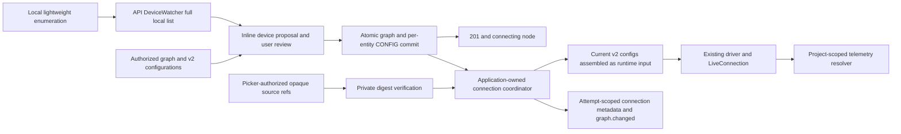

# Architecture — Physical hardware ownership and onboarding

**Last updated:** 2026-11-15 (SOLUSDEV-326 device memory; one session opener). **Status:** integrated 251/250 architecture with explicitly
labeled later SOLUSDEV-253/256 targets,
extending R1–R5 (SOLUSDEV-248). Implementation status and measured results belong in each ticket's
completion report. Governing decisions: ADR-005/012/025/027/029/030/031 and ADR-034 amendment
2026-09-07. [Routes](../api/hardware.md), [wireflow](../wireflows/hardware-onboarding.md),
[storage/migration](../schemas/hardware-config.md), [local runner](local-connections.md),
[workspace](workspace-navigation.md), [private state](../contracts/local-state.md).

The same path handles a loose battery, bracket, controller, custom machine or detected robot.
Saving hardware creates project graph context without requiring a connection, calibration,
CAD, ROS or simulator. Identification produces evidence for review, never asserted ownership.
Vendors remain in plugins and definition data; the path between transport and graph is generic.

## Graph ownership and configuration

Every physical entity belongs to its project. A part may have no robot parent. Optional ownership
is one live manual (source-less) `contains` edge from a live manual robot root to the part
(SOLUSDEV-326: a robot contains its parts directly; `ownership_edge` in
`services/physical_robots.py` is the one rule every reader uses), separate from provider
containment and physical connection/bus mappings. Robot category nodes are retired: migration
a32600000001 re-pointed their `contains` edges to the robot, keeping each category key as the
edge's `attrs.category` label (the only label a CAD/connector part had), and nothing writes a
category node or `part.attrs.category` any more. Do not invent a robot for a part, or arbitrary
nesting for provider assemblies. Assignment, detachment, reassignment and robot removal preserve part UUIDs,
configuration entry IDs, values, provenance, source identity, canonical links and coordinates.
Canvas dragging never changes ownership. Retained and new unassigned parts use the same query
(`GET /hardware/unassigned`; since SOLUSDEV-326 P3 the renderer no longer calls it — the Hardware
page lists manual parts no robot holds from `GET /hardware/parts`) and remain reachable even when
a provider document is their presentation parent.

Each configured entity has at most one active `.solus` CONFIG entry. `EntityHardwareConfig`
schema 2 identifies `entity_id`; optional `component` holds that subject's calibration, limits,
telemetry, firmware and lifecycle. The brains and bus map belong to the entity providing the
connection, including a controller/gateway part. `identity` is a list of brains
(SOLUSDEV-326): each `{kind: host|mcu|onboard, binding?, via?, protocol?}` is one thing this
host reaches (the board on a USB cable, an onboard computer, an MCU reached through it), keyed
by its binding's device ref, with its own driver; each bus row names the brain it sits behind
(null = the only brain), so the same address on two brains is two endpoints. A pre-326 payload
(one identity, a top-level protocol) is read as a one-brain list on every read path. There is no stored robot-level
copy of all mutable part configs. `configured_entity_id`, version and manual `configures` edge
provide indexed, validated subject lookup; only manual entities may carry a convenience
`hardware_config_ref` attribute. Provider-owned properties and external_ref are untouched.

The hardware runtime boundary assembles current referenced component configs into the existing
v1 driver input, which keeps exactly one identity: `resolve_runtime_config` returns the v1
aggregate (first brain's identity/protocol, every row) and `per_brain()` one v1 document per
brain — the brain's own rows (no `brain` key) and the parts they map. A one-brain robot's
document equals its aggregate, so drivers and digests are unchanged. Every session start opens
through one shared opener (`hardware/local_runtime.py`: `plan_session`, `prepare_session`,
`SessionOpener.open`), whichever path starts it: the bench route, the confirm-and-connect
coordinator, or a bound suggestion. It checks the confirmed host and opens each brain this host
can reach, reporting the rest as unreachable (no device, no driver, reached through another
computer, or failing to open); it fails only when none opens. A robot is one session, a merged
connection over its brains, with one window evaluator and per-brain connection state. The v1
write adapter merges its one identity into the stored
brains by device ref and never drops another; a lone part's board moves to a robot through
`hand_over_brain` in one transaction, keeping one config per device project-wide: every config
writer (`put_entity_config`) refuses a device it adds that another live robot's stored brains
hold, binding edge or not (409 `binding_conflict`). Drivers
retain their current protocol and do not learn storage, tenancy or ownership rules. Multiple controllers use actual entities/configs. GET is read-only; deleting
a config does not recreate it on a later read. Expected-version writes, reviewed proposals and
operation idempotency protect concurrency. Graph/config/operation persistence is atomic and
commits before any optional connection; a failed connection leaves the saved node usable.

Provenance names every operational valued leaf. Plugin/library/repo/detected observations
remain evidence and cannot silently replace saved decisions. Ambiguous unit modes remain
unresolved; do not infer degrees from a conditional branch or assume position telemetry on every
part. Supported channels derive from capability evidence. Saved, connectable, session-open,
receiving actual packets and setup-required are distinct statuses.

## Identity, leases and telemetry

Stable identity is transport-specific, such as `usb:<serial>` or `can:<adapter-binding>`, never
a tty path or vendor/driver name. A part endpoint is `<device_ref>/<address>`. Stable refs are
optional at enumeration. Current serial-less devices use `usb:port-<location>` only when a
USB topology position exists. This identifies a port, not a board; moving it fails resolution,
and absent/ambiguous bindings cannot be proposed. Cards and sidebar explain “no serial number —
identity is tied to this USB port; keep it plugged in here”. The shared binding rule is
`recognition/passive.binding_key`. Opaque observation IDs and attachment generations are the
later 253/256 selection model; do not claim they are supplied by the current enumeration schema.
A prior local port hint is not durable reconnect permission. Reliable bindings are re-resolved
after unplug/replug; ambiguous endpoints need fresh user selection.

The approved later 253/256 lease design requires one runner-owned machine-wide lease for every open path: selected interrogation, raw
serial, active sessions and reconnect. An active session owns its port and is not interrupted by
background discovery. Another project sees only generic busy state. Probes have an overall
deadline and cooperative cancellation; cancellation closes/releases resources before a new
owner can open them. HTTP abort alone does not stop a blocking worker. Reconnect factory opens
run inside retry/error handling and re-resolve the current binding each attempt.

**Serial owner (SOLUSDEV-326, built).** Busy used to look like silence, and every open reset the
board. In the local API process every USB-serial open now claims its device ref from
`livebench/hardware/serial_owner.py` first: a session (driver sessions and the legacy line
reader, both `exclusive`), an interrogation, or a presence upload (held for its whole run).

- One holder per device ref. Any other claim raises a typed `DeviceBusyError(device_ref, holder)`.
  The API answers it as `409 device_busy` with `details: [{device_ref, holder}]`. `holder` is
  `session|interrogation|upload` only when the holder and the claim are the same member of the
  same project. It is `null` for a teammate's holder (their session may be on hardware kept out
  of the graph and hidden from this member, docs/api/hardware.md §1a), another project's holder,
  or another program; the OS lock (pyserial's flock, or TIOCEXCL) is how another program shows
  up. A claim with no project or no member works for nobody: it is never told the holder, and
  what it holds is never named. Sessions and the presence upload claim for their project and the
  requesting member.
- The one share: an interrogation of a device that the same member's session holds in the same
  project listens on that session's open port. It gets a bounded copy (64 KiB, newest bytes kept)
  of every byte the session reads. It never writes onto the bus and never re-rates the port. A
  teammate's interrogation is refused, never a listener. The claim (purpose, project and member)
  rides a context variable set around each open, never the open parameters, so a stored config
  cannot name one and no channel or proposal reports one. `POST …/propose` passes no project or
  member yet, so it never listens: a held device is `409 device_busy` with `holder: null`. SOL's
  `hardware.inspect_device` passes both (`detect.propose_via_local(listener=)`), so it listens
  on its own member's session.
- Whether listening would restart a running board is answered with no port opened
  (`SerialOwner.opening_restarts`, `livebench.local.listen_restarts`; SOLUSDEV-326 P2-T4): a
  held device opens nothing (listened to, or busy); a device node the owner already opened — the
  node it cleared HUPCL on, by device number, inode and change time — keeps DTR asserted; a node
  younger than `FRESH_PLUG_S` (15 s) is a board that has just powered up. Anything else may
  restart it, and `inspect_device`'s per-call hook cards it. The kernel makes a new node when a
  device comes back, so a replugged board never matches. Residual: a session that closes between
  the hook's answer and the open lets that one open restart the board uncarded.
- Every port the owner opens has HUPCL cleared, so its last close keeps DTR asserted and a later
  open does not restart an auto-reset board. The first open after plug-in still raises DTR once,
  which is benign because the board has just powered up. The kernel keeps a tty's termios until
  the device goes away, so a replugged board starts with HUPCL set again.
- Interrogation opens the port once and re-rates it in place for each candidate baud; it no
  longer reopens per rate. A board that just restarted stayed silent in its bootloader, so
  listening found nothing. A transport that cannot re-rate is heard once, at the rate it opened
  with.
- Accepted residuals: the owner is per process; outside it only the OS lock stands. A
  card-approved `code.exec` that touches `/dev/ttyUSB*` bypasses it (RECON §2.7).

The existing project-scoped `EntityResolver.resolve(project_id, device_id)` resolves a unique
validated configuration binding, retaining legacy manual external_ref support. Never rewrite an
imported external_ref. Ambiguous live mappings resolve to no target/error instead of first-row
selection. Config/ownership/binding/deletion changes invalidate positive resolver caches. Packet
shape and `LiveConnection`/`PacketSource` interfaces stay unchanged; unclaimed signals remain
unresolved. A ping is not a live data packet or permission for motion.

## Local sources and reviewed proposals

MAIN stores picker-authorized paths/digests and connection hints only in the authenticated
project/account's private `~/.solus/projects/<projectId>/hardware.json`. The exact TS/Python
contract, limits, file modes and corruption/newer-version behavior are in local-state.md.
Shared `.solus` configuration contains portable source references and verified values. Neither
cloud API nor model context receives a local path; a remote repo_root is not read authority.
The local reader canonicalizes the authorized source and verifies bytes against its digest.
Missing/changed bytes require explicit relinking/review, not automatic calibration replacement.
Shared references are `source:<UUID>`; MAIN uses the bare UUID in the account/project private
store. Migrated references can be explicitly relinked through the native picker; selecting a
known file normally reuses its reference, while historical aliases remain valid. Relinking
changes private authorization only and preserves stored calibration values and provenance.
Non-null request `repo_root` is refused before filesystem access, even if a local registry is
missing. Parser/proposal expansion using verified source bytes remains later 253 work.

The local API's `DeviceWatcher` diffs lightweight detection at about 1 Hz only while
subscribed. It opens no ports and publishes full `hardware.devices_changed` lists with
`LiveHub.publish_local`; no device list travels through Redis or the companion. No local
runtime means no watcher. The desktop no longer keeps a detected-device store, canvas rail or Add
panel for these frames (removed in SOLUSDEV-326 P2; the workspace event stream still narrows
them, and P3 hoists the stream to the shell for the Hardware page). Unknown, board and protocol evidence remain distinct.

**Device memory (SOLUSDEV-326).** The machine remembers what it has seen. On each change the
watcher writes into THIS API's machine node in each subscribed project, the
`machine:<companion id>` named by the host's companion identity
(`hardware/device_memory.py`). It writes `attrs.devices` rows
`{device_ref, identity_basis, headline, last_seen, present, state?}`, with no path, under the project lock, and
never publishes a `graph.changed`, whose fan-out would rerun every checker on every plug. A
device that leaves keeps its row and the time it was last seen. `attrs.dismissed` keeps each
member's "Not now" per device until that member clears it; `upsert_machine` carries both
forward. Both stay the machine owner's alone. `GET /detected` and the watcher's frame annotate
each device for its reader with `bound_to` (the holders `bind_device` refuses — live config
bindings and robots' stored brains, which a backfilled config holds with no binding edge — then
part refs, filtered by §1a visibility), the reader's own `dismissed` and the owner-only
`last_seen` and `state`. The frame is built per reader: `LiveHub.publish_local_each` hands each local
subscription the frame for the person its user channel names. The shared binding rule
`binding_of` treats a serial no binding can hold as absent, so one odd device never blanks the
enumeration.

**The plug-in path (SOLUSDEV-326 P2-T6).** No model is called when a device arrives. In the
same write as the memory, the watcher asks `hardware/plug_in.arrivals` which remembered devices
are owed an inspection — plugged in, bound by nothing the owner may see (`device_memory.sees`,
the filter `bound_to` uses, so hidden hardware never changes what the owner reads), not dismissed
by the machine's owner, no
inspection settled since they arrived — and, only while that owner reads the project's stream in
this process, marks them `inspecting` and starts one task each. `plug_in.inspect_arrival` runs
`inspections.inspect_device` as the owner (never when `listen_restarts` says the port's opening
would restart a running board), the watcher records `inspected`, `busy` or `unknown` on the row
(`device_memory.record_state`, only onto a row still `inspecting`: a device that left and came
back is a new arrival) and sends each reader the list again. Once it holds the listen lock, and
before any port opens, the task reads the owner's "Not now" list again: a device dismissed while
it waited is not opened. A result that was not recorded (the replug, a failed write) has the
project told again at the next tick, where the device is owed afresh. Tasks listen one at a time,
live outside the tick and are cancelled by `stop()`; a row left `inspecting` by a process that
stopped is inspected again. The plug-in's inspection is kept `unasked`: the first
`hardware.inspect_device` call for that device within 120 s is answered it
(`InspectionStore.unasked(take=True)`, with `heard_s_ago` so the model knows it is not a listen
made now) and spends it; every later call, and every call after one the tool made itself, listens
again, so "check again" always reaches the device. That one answer is what
brings the first turn after a device notice to its first card in two model calls
(`tests/test_plug_in.py` counts them with a scripted provider). "Not now" is the server route
`POST /devices/dismissals`, which emits `hardware.device_dismissed`; rejecting a device offer's
card (`inspect_device`, `add_parts`, `add_connection`) is the same "Not now", written by the
decide route from the row's stored device (`routers/sol_confirmations.py`, best effort).

**Described, not seen yet (SOLUSDEV-326 P3).** `hardware/expected_parts.py` is the one read of
what the workspace describes and nothing has answered; `hardware.expected_parts` (SOL) and
`GET /hardware/expected` (the Hardware page, `hardware/expected_router.py`) both call it under
the reader's own scope and each cuts the text for its surface.

**SOL's hardware reads (SOLUSDEV-326 P2-T4).** `agent/tools/hardware_onboarding.py` registers
six ungated reads — `hardware.list_devices`, `inspect_device`, `expected_parts`, `list_parts`,
`read_evidence`, `search_library` — thin wrappers over the services above, never over HTTP. They
exist only for a turn bound to a person on an API where `device_watch.watcher_wanted` holds (a
local runner, not production), threaded as `build_sol_registry(hardware_local=)` from
`deps.get_sol_registry`; a hosted API has none and SOL's prompt says so. Each reads as the
requesting member through the turn's bound scope, so §1a holds: a teammate's hardware out of the
graph never appears. An inspection (`hardware/inspections.py`) reads the member's authorized
sources (`LocalHardwareSources.source_refs`, at most 32; a moved or changed one is left out, and
so is one the runner's parsers reject — `livebench.local.propose_device` parses a member's sources
one at a time before the port opens),
writes nothing to the graph and files no link suggestion; its proposal is kept in-process for
that member under an `inspection_id` (30 minutes, at most 64), and the model is answered a
compact summary within the prompt's result cap. The per-turn project card adds the member's own
waiting devices (from the device memory of a machine they own: plugged in, unbound for them, not
dismissed; a teammate's machine is never read for it) and their oldest open card — per request,
never in the shared card cache. A waiting device reads `headline ("device ref")`: the ref can be
the device's own USB serial, so it is one printable line, JSON-quoted as data, as a device notice
says it.

**SOL's hardware card tools (SOLUSDEV-326 P2-T5).** Six writes behind offer cards —
`hardware.add_parts`, `add_connection`, `apply_evidence`, `link_part`, `import_definition`,
`set_in_graph` (`agent/tools/hardware_cards.py`, `hardware_graph_cards.py`) — registered beside the
reads when the turn also has the app's live hub. Each is a thin wrapper over the same services the
routes call (`detection_service.confirm_inspected` / `add_inspected_board`,
`TopologyAcceptanceService`, `graph/edges.write_edge`, `library_import`, `in_graph.set_in_graph`),
as the member through their bound scope, and is gated statically: never an owned routine, never
auto-run. What SOL adds stays out of the graph for its onboarder until `set_in_graph` adds it; a
part created on an existing robot takes the robot's keys. A card is built from the stored
arguments: `stored_args` stamps what the card shows (`shown`, read as the member) and, for
add_parts and add_connection, the member's whole inspection, so approval never listens again — it
only re-checks the device is enumerated. apply_evidence reads the member's file once, at park,
and stamps the kept rows (`evidence`). The preview re-reads `shown` from Solus's own state, never
the local runner or a file, so a flaky read can never make a decision stale; a changed robot or
definition does, and changed evidence is refused by the write itself (the acceptance service
proposes again and compares the digest). add_parts shows the repo config whose names and
calibration it writes; set_in_graph shows the member's wired parts on other hardware that join the
graph with what moves (`in_graph.wired_hidden`, the read-only closure `admit_wired` applies). A lone board streaming lines is one part keyed by its device ref
(`external_ref`) with a channel per column named from the evidence; whether the line driver names
a lone part's columns from that config is P5's live check (`raw-lines` names a column from its
bus-map row's part today).

Current proposals use a bounded cache to avoid duplicate interrogation. Confirmation still
checks present-device identity; a cached proposal is not authority to bind an unplugged device.
The later generation/revision review design also requires current accepted-address, config,
source and ownership checks. Model suggestions remain evidence, not user names or accepted
config choices. Private file parsing and expanded review are not silently enabled by this merge.

## Save before asynchronous connection

The confirmation transaction saves independent v2 CONFIG entries and, when opening is requested,
`properties.connection` with `managed_by: local_runtime`, an API-owned `runtime_id`, an attempt
UUID and status `connecting`.
The response returns before driver opening. An application-owned coordinator uses fresh scoped
sessions, current configurations and the private-source reader; it validates attempt, ownership
and participating versions before opening and accepting completion. Terminal states are
`connected`, `failed` and `disconnected`; session UUIDs and portable errors accompany them where
appropriate. State changes use the existing project-scoped `graph.changed` hint.

Stale completion closes its session. Deletion cancels pending work and closes any associated
session, including acquisitions running in worker threads; shutdown drains the coordinator before
session manager/hub teardown. Startup resets only metadata matching this API's private persisted
runtime identity. A lifetime lock prevents another process using that identity concurrently.
Legacy/unidentified and foreign-runtime metadata remain untouched, as do hardware/configuration.
Saving never claims streaming: only received packets do.
Confirmation latency excludes background opening; correlated receipt/render and connection
measurements are reported separately, with overlap and replug cases included.

## Existing implementation seams

| Area                 | Existing entry points / responsibility                                                                                                                                               |
| -------------------- | ------------------------------------------------------------------------------------------------------------------------------------------------------------------------------------ |
| Transport            | `livebench/src/livebench/hardware/channel.py`, `usb_serial.py`, `usb_can.py`, `bluetooth.py`, `network.py`: port/channel operations behind the existing seam.                        |
| Registry and probing | `hardware/registries.py`, `driver.py`, `interrogator.py`, `detection.py`, `repo_config.py` under livebench: shared registries, enumeration, bounded parsing.                         |
| Plugins              | `livebench/src/livebench/plugins/`: vendor codecs, drivers, interrogators and config parsers; definitions and fixtures may contain vendor specifics.                                 |
| API state            | `packages/api/src/solus_api/hardware/config.py`, `store.py`, `detect.py`, `hardware_router.py`, `library_router.py`: project-scoped storage and reviewed operations.                 |
| API services         | `hardware/detection_service.py`, `library_import.py`, `ownership.list_parts`: what the thin routes and SOL's hardware tools both call (SOLUSDEV-326 P2).                             |
| Manual robots        | `packages/api/src/solus_api/services/physical_robots.py`: robot root creation, the ownership rule (`ownership_edge`) and retention on removal.                                       |
| Runtime              | `packages/api/src/solus_api/livebench/sessions.py`, `livebench/src/livebench/local.py`, `hardware/connection.py`: runtime-optional loading, session ownership and config adaptation. |

These are actual existing files, not a mandate to create a parallel detection package. New
lease/ownership helpers extend these seams with exact file ownership in the execution plan.
`livebench` is loaded by the local API through `load_local`; the companion does not own ports,
telemetry never rides its MCP bridge, and cloud ARQ is not a local-device host. A cloud image
without the local runner returns honest unavailability. A future runner-host move preserves
these boundaries and requires its own documented decision.

## Migration, safety and proof

Separate schema/data revisions preflight all CONFIG history, including deleted owners,
duplicate subject configs, conflicting embedded part values, invalid references and private
paths. Preserve existing graph/robot-config IDs; extract independent part-config entries without
changing part IDs or provenance. Conflicting values are not enabled as limits/calibration.
Replace shared private paths with opaque references without reading legacy paths or guessing
their machine. Validate transformed state before enforcing uniqueness; fail an unrepresentable
v1 downgrade. Reassignment disables stale bindings until reviewed. See storage doc for exact
constraints and the 24-hour project/user operation ledger.

Interrogation allows declared passive/ping/listen actions only. Motion, flashing, deployment,
write-back and destructive changes retain concrete existing confirmation. Simulation is a
separate supported action and never proof of physical safety. No generated driver, per-device
container, OpenUSD or new simulator is part of this design. All device/document/model content is
untrusted; existing graph auth, prompt fencing, budgets and tool admission remain authoritative.

Verify tenant isolation, migration/idempotency races, source-safe imported binding, lease
contention/cancellation, typed recovery, capability honesty and stale scope rejection. Keep the
existing vendor-hygiene ratchets and three-machine fixture proof (recorded UDP/CAN/serial) green.
Record real Electron and available LeRobot tests separately from fixtures; unavailable ELEGOO
is not verified. Measure enumeration/proposal/confirmation/first-packet spans before choosing
optimizations, and do not infer runtime performance from unit test success.

## SOLUSDEV-262 — brain topology amendment (implementation in progress)

The user-approved brain-centric brief supersedes the category presentation above. A robot is
presented as brains → buses → devices → parts. A controller on an upstream bus and a brain
with a downstream bus is one entity. Brain kinds are host, mcu and onboard; unknown firmware,
software or wiring stays unknown. Category is classification/filter metadata, not the presented
tree. Existing ownership remains separate from physical connectivity: one host may control
multiple robots without duplicating its identity. Each robot presents its scoped projection.

Topology is project-scoped graph evidence. Preserve part, CONFIG, robot and canonical IDs,
calibration, provenance, source-owned fields and bindings. SOLUSDEV-326 retired the category
records (migration a32600000001, rehearsed on a restored snapshot copy): the parts a robot
contains join its topology nodes, and a node's `category` is only the legacy label read back
from the re-pointed edge or a manual part. No GET creates graph/config data. Migration adds only
facts justified by stored connection/bus evidence, marks unknowns explicitly, and is rehearsed
on a restored database snapshot before applying to populated data. New discoveries still need
review; the migration is not permission to invent host software or automatically assign devices.

Typed topology reads and reviewed updates use the hardware API. Runtime telemetry remains
Pattern 2 through existing drivers/session ownership. Graph presentation must not create a
parallel transport or move telemetry through MCP. Extraction adapters reuse firmware/repo/KiCad
paths and normalize onboard observations. Their output is evidence, never hidden acceptance.

The present board with CH340 VID/PID has no USB serial. Its bridge identity cannot establish
board model or empty firmware. The session's serial-only automatic QA policy remains inactive
for it; any future flash needs a concrete manual approval using freshly resolved connection
identity. Never infer permission to flash motor-driver boards from the presence of a user.

The first delivered slice persists `hardware_brain` endpoint nodes and `hardware_bus` nodes
from accepted CONFIG evidence. `hardware_topology_member` selects a robot's projection;
`hardware_connected_to` expresses endpoint → bus → retained part connectivity. Neither grants
runtime ownership. Stable project/endpoint-scoped IDs let shared projections reuse entities.
Conflicting channels for one shared endpoint and multiple active addresses for one part on one
brain are rejected transactionally. The migration validates canonical CONFIG nodes/links before writes.
Reviewed host attribution is specified below. Onboard deployment uses the existing desktop
deployment boundary and explicit central confirmation. The initial provider requires an already
enrolled target with a configured companion service and pinned host identity; bare-target
provisioning remains unsupported. An immutable offline bundle, target version and artifact digest
are checked before install/start, and the expected companion handshake is required for success.
No cloud service opens SSH and no fixture is evidence of a live deployment. Unsupported
kind/software/presence facts stay unknown.

From-scratch MCU wiring is a proposal graph node followed by explicit acceptance. Typed pin
declarations, visible schematic graph evidence and retained device-scoped probe observations
converge on a bounded input-only wiring plan. Provider-owned pin validation is separate from
shared graph/provenance logic. Accepted evidence never rewrites runtime CONFIG or permits
driver-board flashing. Preparation and central confirmation revalidate target and evidence;
unknown protocols remain unresolved rather than receiving invented register reads.

**SOLUSDEV-326 — the brain topology is a DAG derived from identity items.** A stored config
lists its brains (`identity: [BrainIdentity{kind, binding, via, protocol}]`). There is no separate
brain writer: `sync_topology` derives the brains from those items in the same transaction as
every robot config write. This matters because a sync soft-deletes every robot-tagged topology
edge it did not derive, and the read shows facts only for nodes this module manages. Each bound
item derives one `hardware_brain` with an id stable across its kind, and `brain_kind` comes from
the item: `mcu`, `onboard`, or none for a host-driven `host` item. A `via` item derives a
brain → brain `hardware_connected_to` edge. Bus nodes are per (brain, protocol). A part may sit
under two brains and a brain may be reached two ways (via a robot computer and through a reviewed
host). Reads refuse only cycles, and they merge evidence and reviewed host facts across a node's
parents. The navigator keeps a first-parent tree and draws every other parent as a cross-link.

A robot computer (P6) enters the graph only through its config item:
`topology.upsert_onboard_brain` writes or replaces the `onboard` item and lets the sync derive
the node. Facts the survey measures land on the node and survive every resync, because a sync
merges its own facts over the node's attrs. These facts are the measured clock
`attrs.clock {offset_ms, jitter_ms, measured_at, method}` and `software`. `clock_source` names
the brain whose clock stamps a part's data (device-timestamped drivers: the endpoint brain;
host-stamped: the host brain above it). Applying the offset at ingest belongs to the Live Bench.
A part shared by two brains carries each brain's `<device>/<address>` as `attrs.ref_aliases`, so
a real session resolves its telemetry from either brain. A part on one brain is unchanged.

Reviewed local-host attachment extends the foundation with one project/machine host and USB
bus, connected to existing controller endpoints. Proposal/confirmation uses the existing
project lock and hardware operation ledger. Caller-owned local source + exact live bridge
session + matching read-only local machine identity establishes this API's physical attachment;
a client-supplied machine ID alone does not. Software is an explicit graph-backed declaration,
not a claim that a process or shim is running. Shared host projections retain separate robot
association evidence. An attach is scoped to its endpoint (SOLUSDEV-326). The shared
robot → host and host → USB edges record every endpoint they serve, so a robot's second USB brain
joins the same host without erasing the first. CONFIG resync cannot erase valid reviewed host
edges or retain links to an obsolete controller binding. See the hardware API's local-host section for exact routes.

### SOLUSDEV-262 extraction evidence boundary

Source adapters normalize already-authorized parser results or project-scoped electrical graph
observations into bounded, immutable records with `bus`, `device`, `protocol`, `address`, and
optional `part_candidate`, plus source namespace and provenance. These are candidates, not graph
assignments. Preserve unknown fields, contradictory evidence, original pin/address text, and
source/entity references. Distinguish an empty successful extraction from unavailable or invalid
input. Deterministic normalization deduplicates exact evidence only within its source namespace.

The existing API hardware layer owns this internal model, consumed by the existing Live Bench
parser adapters. Firmware/config adapters reuse current parsers; schematic adapters consume the
existing component-to-net graph and its pin arrays; onboard adapters consume supplied recorded
observations. This boundary performs no filesystem acquisition, commands, device I/O, or graph
mutation. Local graph/source association alone never authorizes reading a path. Runtime use must
pass through an explicitly documented authorized proposal/confirmation path; topology GET remains
read-only and host attachment does not implicitly execute extraction.

### Authorized single-file extraction review

The existing native hardware-source picker grants one-file access, recorded privately per
account/project with a content digest. Extraction resolves only that opaque source reference
through LocalHardwareSources on the authenticated local runner. It never scans the parent
folder, follows a graph path, creates a temporary checkout, or executes selected code. Firmware
and structured-config parsers expose bounded byte entry points shared with existing readers.
Native paths are removed before candidates enter the response. Initial acquisition accepts the
existing JSON/YAML/TOML/Python formats; folder and C++ picker expansion are separate capabilities.

The proposal route is read-only and binds robot/brain scope, verified source bytes and canonical
evidence into a digest. A candidate review does not create operational CONFIG or grant device
access. Arbitrary extraction confirmation is deferred until explicit selections, names, retained
identity and non-operational evidence storage have a documented acceptance shape.

### Reviewed extraction application

Explicit selected evidence rows may be accepted through extraction/confirm, after the proposal
is recomputed under the project lock. This creates evidence-only graph nodes/relations connected
to the selected brain or enriches explicitly retained robot entity IDs. It is separate from
operational CONFIG and from the endpoint projection marker; CONFIG synchronization cannot delete
independently reviewed evidence. Candidate similarity grants no device ownership or runtime access.

### Presence preparation and execution

Presence preparation generates bounded source from an explicitly selected provider profile and
reviewed topology; it never modifies an existing firmware project. The vendor-owned compiler
adapter builds source plus bundled telemetry library in a private temporary directory with pinned
binary/profile arguments, timeout/output/size limits, and process cleanup on cancellation. Prepared
source and binary are immutable retained project artifacts, with SHA256 and target connection
snapshot. Preparation performs no upload or device writes. Supported initial sketches are a
heartbeat and an I2C/analog probe. Analog samples are raw observations, not evidence of attached
parts; absent I2C responses mean no responding devices, not proof every pin is unwired. Generated
command protocol accepts status queries only; it contains no actuation commands.

Execution must be a registered confirmation-required tool through the existing SOL gate; the
preview shows full generated source, profile, exact target identity, binary digest and erase warning.
Decision-time revalidation checks source/binary digests, selected connection identity and exclusive
ownership. A serialless target requires explicit manual profile selection and a fresh connection
snapshot; the automatic QA approver remains ineligible. Existing motor-driver boards are excluded
from this session's flash capability. A denied/stale card reaches no device; interrupted upload
reports unknown firmware state. There is no ungated production flash route or raw shell tool.

### Host I/O mirroring

A host-side adapter may publish completed observations through the existing authenticated
`POST /projects/{project_id}/bench/telemetry` route. One program owns each physical serial bus;
Solus does not open a second connection to observe an externally controlled robot. The generic
Python HTTP publisher validates LB-06 packets, queues bounded copies and sends bounded batches
on a background thread. HTTP runs outside the motor loop; slow, rejected or unavailable ingestion
drops telemetry and exposes counters, never changes commands or retries stale control samples.
Explicit URL, project, device identity, signal mapping, units and user access token are required.
No credential extraction, implicit authentication or control permission follows from ingestion.

The existing method shim observes explicitly selected completed synchronous calls without extra
reads or altered results. Alternatively, a controller submits copies immediately after its existing
reads. Measured position and commanded targets remain separate quantities. Raw encoder counts
use `encoder_count` with `tick`; normalized position uses its verified normalization unit. The
receiving graph resolves part identities through the existing project-scoped resolver. An
unconfirmed identity remains unresolved, even when visible in the device view.

Live Bench discovers recently ingested external device IDs separately from serial sessions;
server receipt time determines discovery expiry. Discovery does not fabricate sessions, take
ownership, or imply recording/control support. Source insertion still uses the existing reviewed
local-file diff for app tools; linking a folder is not permission to edit an external controller.
The older loopback UDP sink is a low-level library option, not a completed UDP/JSON-lines robot
onboarding flow; its receiver identity checks must not be weakened to impersonate USB devices.

Presence compilation/upload lives behind the plugin boundary: `plugins/arduino/presence_provider.py`
owns board profiles, compatible USB identities and protocol eligibility. `livebench.local` delegates
discovery through the plugin roster; shared graph orchestration does not name a board vendor.
Retained, CONFIG-authorized part identities can ground partial-map rediscovery by exact device
reference and bus address; only a unique canonical owner yields a suggestion. This preserves
partial mappings instead of treating additional unaccepted responders as conflicting identity.
