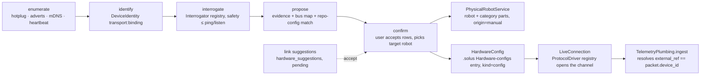

# Architecture — Robot onboarding (SOLUSDEV-248: R5 → R3 → R1 → R2 → R4)

Product source: the SOLUSDEV-248 ticket brief (no docs/design spec exists in the repo).
Governing decisions: ADR-005 (clean seams), ADR-012 (heuristics + human confirmation), ADR-027
(graph conventions), ADR-029 (runtime data is untrusted model input), ADR-030 (live data never
rides the Connector sync path), ADR-031 Pattern 2 (telemetry is never an MCP tool), ADR-034
(2026-09-06 amendment: a Hardware-configs entry may carry a schema-validated structured payload,
one per Physical Robot, provenance on every field). Routes: `docs/api/hardware.md`. UX:
`docs/wireflows/hardware-onboarding.md`. Companion docs: `local-connections.md` (the bench-session
seam this extends), `workspace-navigation.md` §Phase 4 (`PhysicalRobotService`, the R2 hook),
`docs/contracts/telemetry-packet.md` (the packet and its `units` map).

The thesis: plugging a machine into Solus yields a **proposal, not a form**, and one code path
onboards a Feetech arm, a PX4 drone, an ODrive base and a bare Arduino. Vendors live in plugins and
definition files; everything on the path between the USB port and the graph is vendor-free.



## Identity — `transport:binding`

`DeviceRef = f"{transport}:{binding}"`: `usb:5B42134331`, `can:<iface>:<adapter-serial>`,
`ble:<addr>`, `ip:<mac-or-ip>`. A part on a bus is `f"{device_ref}/{address}"` —
`usb:5B42134331/1`. The identity is the USB serial (or the transport's equivalent), never a tty
path: paths swap between runs, serials do not. `DeviceIdentity` carries
`(transport, binding, vid, pid, last_seen_path)`; `last_seen_path` is informational only.

The ref is what confirm writes to `graph_entity.external_ref`, and `external_ref` is what telemetry
resolves on (`graph/resolver.py`: `external_ref == packet.device_id`). So the key must never carry
a vendor — the confirm schema's regex is a **transport-prefix allowlist**; the driver id lives in
the config, not the identity. Reconnect re-resolves the binding (USB serial → `/dev/serial/by-id`)
inside the factory closure on every cycle, so a replug into a different port reopens the same
physical machine without touching the `PacketSource` protocol.

## Layout — shared vs plugin (ratchet-enforced)

| path                                                              | vendor names | contents                                                                                                  |
| ----------------------------------------------------------------- | ------------ | --------------------------------------------------------------------------------------------------------- |
| `livebench/src/livebench/hardware/identity.py`                    | forbidden    | `DeviceRef`, `DeviceIdentity`                                                                             |
| `livebench/src/livebench/hardware/transport/`                     | forbidden    | `Channel` protocol (open/read/write/close/identity); `usb_serial`, `usb_can`, `bluetooth`, `network`, `ros2` (presence-only); registry |
| `livebench/src/livebench/hardware/drivers/`                       | forbidden    | `ProtocolDriver` protocol: `driver_id`, `param_schema`, `open(channel, params, definitions) -> PacketSource`; registry (`ConnectorRegistry` pattern) |
| `livebench/src/livebench/hardware/interrogators/`                 | forbidden    | `Interrogator` protocol: `id`, `transports`, `safety ∈ {passive, ping, listen}`, `probe(channel) -> Interrogation`; registry |
| `livebench/src/livebench/hardware/detection/`                     | forbidden    | `enumerate.py`, `interrogate.py`, `propose.py` (proposal + repo-config match + disambiguation), `repo_config/` (generic YAML/JSON/TOML/py-AST readers + `RepoConfigParser` registry) |
| `livebench/src/livebench/hardware/definitions/usb_boards.py`      | data only    | the VID/PID table                                                                                         |
| `livebench/src/livebench/plugins/<vendor>/`                       | allowed      | `feetech`, `dynamixel`, `odrive`, `myactuator`, `mavlink`, `lb06`, `jsonlines`, `raw`, `repo_configs/lerobot.py` — codec, driver, interrogator per plugin |
| `packages/api/src/solus_api/hardware/`                            | forbidden    | `config.py` (HardwareConfig), `lifecycle.py`, `links.py` (suggestion engine), `library.py`, `router.py`, models |
| `packages/api/src/solus_api/hardware/definitions/{parts,platforms}/*.yaml` | allowed | the Solus-curated seed library; `definitions/vendor/` is the typed ingest seam for vendor-shipped files (not live this cycle) |
| `libs/solus-telemetry/`                                           | n/a          | MIT emitter library: `python/` (uv member), `arduino/`, `micropython/`                                    |

`Interrogation` is `(evidence: list[ModalityMatch], bus_map: list[BusEntry], driver_id | None,
confidence)` — the one output shape, so R5 persists with zero translation and the CTR-08 hardware
modalities (`BUS_ENUMERATION`, `FIRMWARE_SYMBOL`, `TELEMETRY_CHANNEL`) become load-validated.
Dynamixel framing and ODrive heartbeat parsing move out of `recognition/passive.py` into their
plugins; `passive.enumerate_usb_serial` / `identify_port` stay shared and are reused by `enumerate`.

## HardwareConfig — the `.solus` document (R5)

One entry per Physical Robot in the Hardware-configs section: `solus_entries` gains
`SolusEntryKind.CONFIG` and a JSONB `payload` validated by the `HardwareConfig` Pydantic model on
every write; `physical_robot.attrs.hardware_config_ref` holds the entry id. Parts stay in the graph;
the entry references them by entity id. This is configuration, not a second store of graph facts.

```
schema_version, robot_entity_id,
identity: {transport, binding, vid, pid, last_seen_path},
protocol: {driver_id, params: {baud, timeout_s, protocol_version, …}},   ← validated by the
bus_map: [{protocol, address, part_entity_id, model}],                     driver's param_schema
parts: {<part_entity_id>: {calibration: {values, mode, source, owner: repo|solus},
                           limits: {values, provenance},
                           telemetry: {channels: [{name, unit}]},
                           firmware: {…},
                           lifecycle: planned|ordered|received|installed|live}},
disambiguated_by: user|null
```

Every leaf is `{value, provenance, source?}` with `provenance ∈ library|repo|user|sol|detected`.
Layers apply **library → repo → user → detected; later wins; provenance records who won**
(`sol` marks a value a SOL action wrote through the confirmation gate — it lands with the user's
confirmation and takes the user layer's slot). Parameters live in config, not code: baud, ids,
timeouts are values the driver validates, never constants a driver hardcodes.

- Units derive from calibration mode: `degrees → deg`, `range_0_100 → %`, `range_m100_100 → %`,
  legacy `LINEAR → mm`. Signals are named `<part>.<quantity>` (`shoulder_pan.position`) with the
  unit in the packet `units` map — never units in names (`telemetry-packet.md` addendum).
- Repo-owned calibration (`owner: repo`, e.g. lerobot's HF-cache JSON) re-imports on
  `detect_changes` via a stat fingerprint of `source`; solus-owned edits offer write-back through
  the confirmation gate. Provenance records the machine-local path it came from.
- **Lifecycle** is a config edit keyed by the part's entity id: promotion `planned → ordered →
  received → installed → live` never changes the id or any graph edge.
- Detected and authored parts carry `origin="manual"` (keeps `editableRobot` rights, keeps
  connector sweeps off the rows); provenance lives in the config, not in `origin`.

## Link suggestions (R5) — precision over recall

`hardware_suggestions` (`project_id`, `subject_ref`, `candidate_robot_id`, `confidence`,
`evidence` JSONB of `ModalityMatch`, `status pending|accepted|rejected`). Confidence tiers are the
CTR-08 bands: bus-enumerated ≤ 0.92, firmware ≤ 0.55, telemetry-shape ≤ 0.30. Two plausible robots
→ two rows; below threshold → no row; **nothing auto-accepts** (ADR-012). A library-imported robot
plus a detected device yields one suggestion, never a second robot. Routes:
`GET /hardware/suggestions?status=`, `POST /hardware/suggestions/{id}/accept|reject`.

## Transport host

Transports live in `livebench/`, loaded by the local API process through the existing `load_local`
seam (`app.state.bench_local`, `local-connections.md`). The companion owns no ports and
`bridge-protocol.md` bans telemetry (and binary framing) on its channel, so "companion-side" is
not literally possible today. Companion hosting is a later ticket; the seam is preserved — routes,
`LiveConnection` and the tap contract stay, only the host of `livebench.local` + the pump moves.
`BenchSessionIn` gains `{provider: "robot", robot_entity_id}`: the session opens from the robot's
config via the driver registry (`local.open_robot(config)`). Driver-built connections set
`provider` and implement `aclose()`, the two traps `PacketStreamLiveConnection` leaves open.

## Safety

Interrogators declare `safety`; the detection loop runs only `passive`, `ping` and `listen` probes
(a broadcast ping or a read of a heartbeat is safe on every supported bus). Anything that commands
motion — RBT-04 active identification included — stays behind `request_confirmation` with the
concrete action shown, regardless of how the request originated (CLAUDE.md §7).

## Routes (tier-1 plan `docs/api/hardware.md`, prefix `/projects/{id}`)

`GET /hardware/detected` · `POST /hardware/detected/{device_ref}/propose` ·
`POST /hardware/detected/{device_ref}/confirm` · `GET|PUT /hardware/robots/{robot_id}/config` ·
`POST /hardware/robots/{robot_id}/parts` (Authored: name, category, specs) ·
`POST …/parts/{part_id}/lifecycle` · `GET /hardware/library?q=` ·
`GET /hardware/library/{kind}/{id}` · `POST /hardware/library/platforms/{id}/import` ·
`POST /hardware/library/parts/{id}/import {robot_id, category}` · suggestions as above. Every
route: `ProjectCtx`, MEMBER on writes, a cross-tenant test, events emitted on every mutation.

## Generalisation proof (Phase 6)

- **Three machines, one path**: PX4 (recorded UDP), ODrive (recorded CAN) and an Arduino rover
  (recorded float dump) run enumerate → … → `LiveConnection` from fixtures; a `sys.setprofile`
  module tracer asserts the set of executed non-plugin modules is identical across the three.
- **Vendor-hygiene ratchet**: a word-boundary regex over `livebench/hardware`, `solus_api/hardware`,
  the detection loop, the config schema and the transports (allowlist: `plugins/`, `definitions/`,
  fixtures), plus a vitest twin over the desktop's shared hardware code — both in existing CI jobs,
  so a desktop-only or docs-only MR cannot slip a vendor past a Python-only check.
