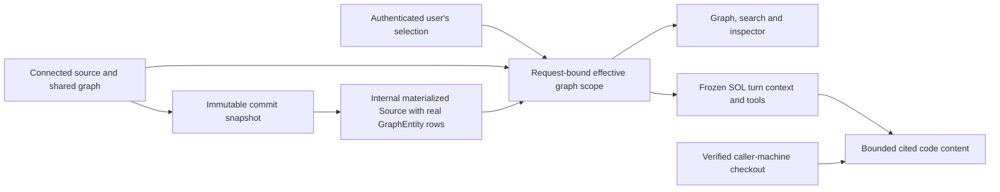

# Personal source revision views — SOLUSDEV-260

The user approved personal branch selection and current saved local files as the
default when a local checkout is proven to match. A branch selector must not patch
shared Source.config or replace another member's graph.

A SourceRevision records base_source_id, commit_id, materialized_source_id and
branch provenance. An internal Source uses existing connector output, GraphEntity
UUIDs and source-key uniqueness. It is immutable after successful acquisition and
excluded from ordinary sources, scheduled sync and default graph reads. Reusing a
commit reuses its completed snapshot; a branch is a display label, not immutable
identity. Source deletion cascades through revisions and selections. Credentials
are resolved from the currently connected base source, never copied into a snapshot.

A SourceViewSelection is keyed by project/user/base source and records active ready
revision plus pending request and failure status. Selection changes are personal.
Snapshot acquisition is bounded background work; only a successful complete snapshot
becomes active. Failure preserves the previous view. Replaced requests cannot win
late. The base graph remains the default for users without a selection.

One GraphReadScope excludes all internal sources then substitutes each selected
ready snapshot for its base source. Apply the same scope to graph/entity lists,
search, neighborhood, relations, retrieval and SOL tools. A SOL turn freezes its
scope at admission; stale mentions outside it are refused with a refreshable error.
No hidden branch may enter context through an alternate read tool. Internal sources
are not independently configurable or attachable through generic source routes.

Provider capability is explicit: GitHub and GitLab support branch listing and
immutable Git commits. Other providers retain their native semantics (Onshape
workspaces/microversions are not Git refs) and report unsupported until an adapter
implements consistent revision acquisition. No fake branch menu is exposed.

Local content is read through the caller's existing companion after fresh Git
identity and machine binding checks. Saved local changes are labeled as local;
no checkout, stash or reset is performed. An explicitly selected remote revision
must not silently read a different local branch. The local folder remains a named
root with its dependencies presented beneath it and a clone_of link to its repo.
