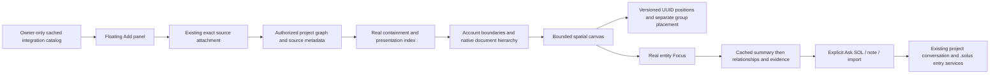

# Architecture — Workspace navigation, Integrations and inspector

**Last updated:** 2026-09-11. **Status:** integrated SOLUSDEV-250/260 navigation, retaining
explicitly identified 254/255/256 follow-up design, extending
W1–W4 (SOLUSDEV-240/242). Governing decisions: ADR-001/005/008/025/027/030/034.
[Wireflow](../wireflows/workspace.md), [workspace routes](../api/workspace.md),
[.solus routes](../api/solus.md), [hardware ownership](hardware-onboarding.md),
[Focus contract](../contracts/focus.md), [change signals](change-signal-spine.md).
No graph domain or Focus contract changes. Completion reports distinguish the approved target
from implemented behavior and measured results.

## Real graph identity and presentation

`contains` is parent→child, `part_of` child→parent; other edges remain cross-links. A
deterministic presentation forest resolves multiple parents/cycles without mutating the graph.
Additional links retain their real endpoints and counts. Actual selection always addresses a
real UUID with truthful graph ancestry, independently of the two-hop focus query cap.

Integrations use presentation account groups keyed by provider plus proven provider account
identity. If identity is unavailable, use distinct existing connection/source fallbacks until
proven. Never key groups by display name or invent EntityRef/graph UUIDs for headers. Project
source metadata supplies teammates' attached-source groups; the owner-only connection catalog
supplies Add choices. It must not expose another account's private document/repository listing.

Display provider logo and readable account name, then real imported document/repository roots
and their native hierarchy. Preserve `AccountInfo.name` separately from login/external ID when
already supplied by an authorized response, and mirror it into project source display metadata.
For Onshape, prefer the authorized session display name, then account email; if neither is
available use an honest provider account label, never the opaque provider id as the username. Do not broaden OAuth permissions to obtain display data.
Onshape preserves document→assembly→part; Git preserves repository→directory→file. Exact
account/document/repository/branch matching prevents duplicate imports. Unbound sources remain
separate until identity is proven.

`.solus` remains the real top-level configuration node with five section entities and real
entry/artifact graph identities. Text remains authoritative in solus_entries. Robots remain
independent manual roots with existing category nodes, but empty categories may collapse/hide
in presentation. Parts may remain unassigned and independently configured. Retained parts are
reachable through Hardware search and the inspector even when provider containment supplies
their normal presentation parent. Group membership and canvas position never assign hardware.

## Canvas interaction and persistence

Remove the full-width toolbar and retained-parts strip. Opaque Add anchors upper left; compact
help/navigation anchors upper right. Back, save/conflict/error feedback and explicit arrange
controls are discrete and do not obscure the canvas. Panel sizing follows available viewport
and content with wrapping/scrolling, stable loading anchors, keyboard tabs and focus return.

The incoming 250 navigator uses hover + wheel inward to enter the hovered card's immediate
children and outward to go up one level. Double-click, keyboard, parent chip and Help → Project
overview are equivalent hierarchy controls; leaves select without entering an empty level.
Click selects; body drag excludes inputs/buttons and crosses a movement threshold. Coordinates
remain transformed correctly and keyboard movement/reduced motion remain supported. This is the
current integrated interaction; the earlier plain-wheel-pan redesign is not claimed implemented.

Preserve UUID-keyed saved coordinates across reload/import/refresh. Generate initial positions
once and persist them: subsequent imports place new nodes without rearranging existing defaults.
Spatial account/group boundaries expose useful populated assemblies and individual parts.
Current account anchors are client-only presentation nodes (`account:<key>`, integration domain
sentinel), grouped by proven connection identity with source fallback. They never enter shared
Focus or `PUT /workspace-layout`. Under the September 15 UI brief, their positions persist in
separate account/project-scoped local presentation preferences, with finite bounded coordinates.
Real entity UUID coordinates remain project-shared. Shared typed group placement remains later
work; local preferences never manufacture graph UUIDs or enter shared Focus.
Explicit arrange/reset is the only automatic layout rewrite requested by a user.

Initial placement uses deterministic organic packing near the current parent, with non-aligned
offsets and collision avoidance, rather than grid cells or a tree layout. Existing saved points
are never recomputed. Visible projected edges aggregate real relationships and counts, draw
curved paths with midpoint labels, and distinguish cross-domain links from quiet containment.
Pending suggestions use existing project-authorized proposal evidence and explicit decisions;
rendering them never generates or accepts links.

Small graph overviews may fit the visible card bounds using presentation zoom without changing
world coordinates. Drag deltas are converted back into world units before persistence. Framing
is recomputed for viewport or visible membership changes, never to rearrange a dragged node.

Keep the documented 24-card visible bound and explicit additional-child navigation until measured
rendering evidence justifies a separately documented bound. Project snapshots may be complete;
render/layout work is bounded to visible content, with projected cross-links preserving actual
endpoints. No force solver runs across hidden entities. Camera state is presentation state,
not provider or ownership data.

Layout saves remain project-shared and versioned. Preserve the latest pending moved-node set
while a write is in flight. On conflict, load the newest layout and offer explicit resolution;
retry applies only the user's changed positions without erasing teammate coordinates. Unknown
fields, cross-project IDs/group keys, nonfinite or oversized coordinates are rejected.

## Cache, imports and live refresh

Reuse the current cached I1 listing. First expansion is cache-only; Load documents and Refresh
are explicit provider operations. Refresh accounts discovers new Home connections. Reopening a
cached catalog, selecting nodes, entering levels, dragging, zooming or refreshing graph data
performs no provider call. First selection attaches/syncs a real source; reselecting a completed
source focuses its existing root. Errors remain inline with Integrations recovery guidance.

The existing authenticated project event stream invalidates snapshots on committed graph hints.
Initial readiness validates project version to close the subscribe/snapshot race; reconnect
refreshes Solus data only. A committed graph-change hint always invalidates the display, even
when `MAX(updated_at)` and counts compare equal: timestamps are not commit-order revisions.
Hardware full-list frames are local-only. Their authoritative arrival supersedes any pending
GET seed; neither old stream nor old seed may repopulate another account/project scope. Permission failures stop retries. Every async operation is scoped by a
monotonically increasing account/project generation; old results cannot revive after A→B→A.
The existing local provenance migration for Onshape document wrappers preserves assembly/part
IDs and makes no provider call. Manual robot edits publish graph hints after commit.

## Sidebar and explicit SOL actions

`NodeSidebar` replaces the inspector: robot/category routes to the robot sidebar; `.solus`
root/section/entry routes to its sidebar; account anchors use local account details; other real
entities show cached focus summary and neighbors. Per-robot detail refresh follows invalidation,
not a graph refetch for every click. Connection metadata renders connecting/connected/failed/
disconnected separately from actual packet reception. Serial-less identity copy appears here
as well as on the device card. Import/note expansion for every arbitrary node remains follow-up
work where no existing handler provides it.

Render selected local/cached summary promptly. Load relationships, evidence and connection details
progressively with honest loading/failure states. All supported nodes expose visible Import files,
Ask SOL and Add note actions in addition to relevant type-specific controls. A retained part can
be assigned/reassigned explicitly through the versioned ownership API.

Selection makes no model call. Explicit Ask SOL opens the existing SOL window with the real
selected node as subject, preserving current project/account context. Submission carries the UUID in existing
`MessageCreate.mentions`, uses the current project conversation and consumes Guide/Expert mode,
action mode, budget admission and confirmation infrastructure. Bind each submitted turn to its
submitted entity, even if selection changes; stale account/project results are discarded. Do
not create a fresh chat for every click or invent a parallel agent service.

Notes/imports use existing project `.solus` sections, entry rows and artifact storage. A validated
optional context entity adds a manual `references` edge to the new entry graph node. It does not
edit source-owned content. Section/entry handlers, file/text limits, retention and deletion remain
shared. A failed upload/entry write creates no context edge. All retrieved content stays untrusted
model data and cannot change tool/auth scope.

## Verification

Use ProjectCtx/member writes; validate project-scoped IDs, versions and manual-edge permissions.
Required regression cases include account identity/fallback and teammate visibility, cached
provider-call counts, focus correctness, body drag versus controls, accessible responsive Add,
persisted positions after repeated imports, concurrent layout changes, retained-part reveal,
context isolation and no model call on selection. Preserve SOL budgets/refusal/confirmation tests.

Measure actual Electron panel→paint, select→summary, drag frame durations and graph refresh on a
representative 243+ entity graph with recorded machine/viewport/build/card counts and p50/p95/max.
Targets are ≤100 ms local feedback and roughly 16.7 ms drag frames, not assumed results. Record
actual desktop runs separately from component/API fixtures and fix review findings before handoff.

## Performance evidence

Confirmations use per-attempt marks rather than global marks that collide across devices.
Repeated device appearances begin new receipt-to-card spans. These spans start at browser
receipt, not physical plug-in; OS detection latency is measured separately. Target confirm
response-to-node well under 500 ms, sidebar feedback under 100 ms, and bounded drag/render work.
Targets and unit fixtures are not claims of measured native performance.
