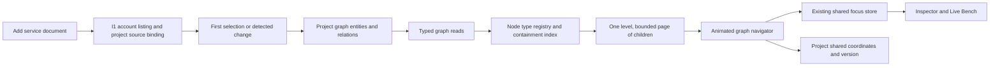

# Workspace graph navigation — SOLUSDEV-242

Approved direction: the combined W1 fix + W2 + W3 + W4 request and the Phase 0
approval in this session. Product source: the approved combined Workspace request; the
design spec cited previously (`docs/design/screens/SPEC.md`) does not exist in the repository.
Governing decisions: ADR-001, ADR-005, ADR-008, ADR-025, ADR-027, ADR-030, ADR-034.
Focus remains `docs/contracts/focus.md`; integration reads follow
`change-signal-spine.md`. No shared contract or new domain is required.

## Navigation and layout

- The registry declares each node type's children from graph containment. `contains`
  is parent → child; `part_of` is child → parent. Other relations remain cross-links.
- Build a deterministic forest without changing graph identity: multi-parent containment
  chooses one presentation parent; additional edges remain visible links. Break cycles
  in the presentation only. The graph remains authoritative and unchanged.
- Render at most 24 entity cards in a level; additional children use explicit paging.
  Cross-links project onto visible ancestor cards, retaining counts and their real endpoints.
  Links outside the current level are surfaced, never silently treated as containment.
- Hover + wheel inward enters one level; outward goes up one level. Double-click/keyboard
  and breadcrumbs provide equivalent navigation. Animate from the selected card to the
  next level; honor reduced motion. Leaves do not trigger a new zoom or source sync.
- Navigation depth is independent of the existing two-hop focus-query cap. Selection at
  every depth addresses a real graph entity and supplies the path to the focus adapter.
- `.solus` is the first centered top-level card at (0,0); new roots receive deterministic
  surrounding positions. Dragging saves project-shared coordinates, separately from
  connector properties. Version conflicts stay visible and are resolved against a fresh layout.
- Existing graph reads may fetch the complete project snapshot; rendering and layout are
  limited to the visible level. No simulation or force solver runs over hidden entities.

## Types added in sequence

1. Generic graph nodes and containment: fixture three levels, cross-domain links, focus.
2. `.solus`: preserve its existing entity, artifact store, entry rows and action handlers.
   Five `solus_section` entities and graph identities referencing note rows provide selectable
   children. Add `contains` edges; preserve existing document `references` for Impact.
   Migrate existing entries idempotently. Text remains in `solus_entries`, not duplicated facts.
   Remove the panel and reuse its composers/menus on node cards.
3. Service nodes: Onshape document roots contain existing assembly/part trees; Git roots
   already contain directories/files. Source identity stays project-scoped and payload cache
   identity stays account/document/version-scoped. Add uses existing I1 APIs. A mounted
   account listing is reused on dropdown reopen; no node select or zoom invokes sync.
   A cache-only listing read must expose an honest empty/missing state rather than silently
   spending provider quota. Explicit listing refresh and first-select ingestion are distinct.
4. `physical_robot`: independent manual graph instances with seven category children.
   Default name is the project name. Hardware-config and transport references are nullable
   placeholders for R5/R3, with no invented schemas. A single creation service is the R2 hook.
   Confirmed deletion soft-deletes its containers/ownership edges, retains parts and their
   unrelated edges, and shows unassigned parts with a prompt. No fingerprint auto-linking.

## Security and verification

All backend access uses ProjectCtx; writes require member role. Graph mutations allow only
manual-owned nodes. Cross-project coordinates, references and graph edges are rejected.
Unknown fields, invalid coordinates and oversized payloads are rejected. Structured events
record layout and node changes. Existing SOL confirmation/refusal and never-raises behavior,
fingerprint identity and tool-knowledge tenancy boundaries are unchanged.

Each phase has tests before implementation, a review and a local commit. Final verification
includes a running application, bounded-render performance on 243+ entities, zero provider
calls for dropdown reopen and node navigation, persistence, tenant isolation, robot orphaning,
desktop build/typecheck/tests, backend ruff/mypy/tests, and a single Alembic head.

## Phase 3 service attachment and live refresh

`WorkspaceAdd` retains the I1 account catalog across panel visits and projects for the
current identity. The first expansion uses `cache_only=true`; only **Load documents** /
**Refresh documents** asks I1 to populate its shared listing. A project attachment controller
reads every source page once, matches the exact account/document or repository/branch, and
observes the accepted import job. Reselecting a completed document uses local state and graph
focus only. Failed imports keep their error and Sources recovery guidance on reselection.

Onshape emits a stable `cad_document` wrapper, keyed `<document_id>:document`, around the
existing assembly/part identities. Migration `c7f242e9a842` adds wrappers to legacy graphs using
local provenance; it does not fetch or re-export CAD. Git's existing repository hierarchy is
reused. Per-project source/node identities remain separate from shared account/version payloads.

The existing authenticated `/projects/{id}/events` SSE stream invalidates the displayed graph
on committed `graph.changed` hints. Initial readiness validates project version to close the
snapshot/subscribe race without forcing an unchanged entity walk. Reconnection catches up by
refreshing graph data. Every snapshot uses its own typed transport; obsolete requests cannot
repopulate retained state. A monotonically increasing account/project session generation prevents
pending work from reviving after A → B → A, including uploads and service attachments. No stream,
selection, zoom, dropdown reopen or layout operation requests provider synchronization.

## Phase 4 manual robot ownership

`PhysicalRobotService` creates independent roots and seven category entities in
one caller-owned transaction. The entity routes and later R2 detection share
this creation hook. Root config/transport references are null placeholders.
Names and deletion use entity versions under a project row lock. No manual
mutation can edit connector, fingerprint or `.solus` entities through this path.

Deletion removes only explicitly owned robot containers/containment edges.
Soft-deleted ownership evidence supports a paginated query for retained parts
without an active robot owner. The Workspace prompt reveals their real graph
IDs even if a CAD document remains their presentation parent. It persists across
reloads; no connector properties or unrelated edges are changed to mark orphans.
Project detail's greatest graph modification time invalidates cached manual
renames. Manual writes publish the existing SSE hint after commit with null
source/sync IDs, keeping service synchronization out of this path.
Focus reconciliation waits for the refreshed authoritative snapshot. Removed containers
clear selection without a failing neighborhood read; retained parts keep their real
identity and obtain the surviving containment path from the same navigator index.
