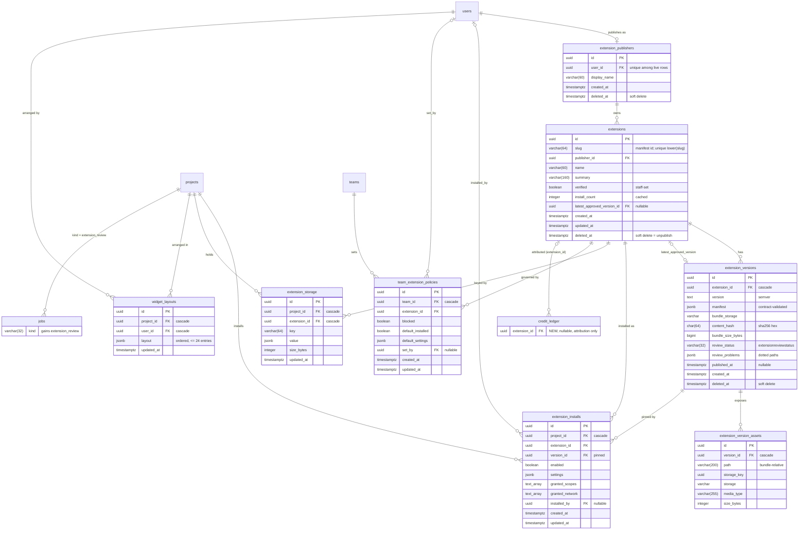
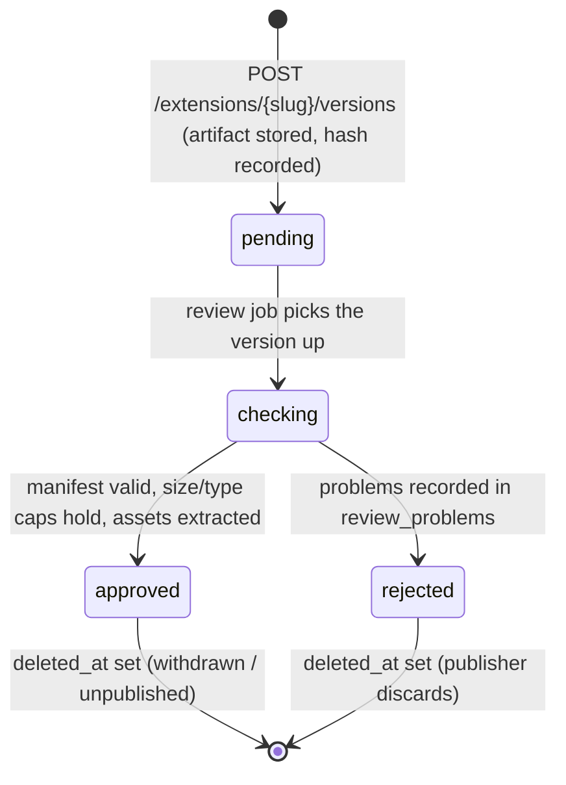

# Extensions — database schema

**Ticket:** SOLUSDEV-235 · **ADR:** ADR-035 (with the ADR-034 amendment of 2026-09-03) ·
**Conventions:** ADR-027 (uuid7 primary keys, `deleted_at` soft delete, JSONB for structured
payloads, VARCHAR+CHECK enums via `_enum_column`) · **Tier:** 1 (agent-editable, reviewed at the MR).
**Models:** `packages/api/src/solus_api/models.py` · **Migration:** one Alembic revision,
`solusdev_235_extensions` (task EXT-03) · **API:** `docs/api/API.md` §2.17 Extensions (task EXT-01) ·
**Manifest shape:** `docs/contracts/extension-manifest.md` · **Local cache:**
`docs/contracts/local-state.md` (`~/.solus/extensions/`).

## 1. Purpose

The Store (`docs/wireflows/store.md`) installs _extensions_: versioned bundles that add widgets,
pages and windows to a project. ADR-035 splits the problem into an **open registry** (anyone
signed in may publish; an ARQ review job validates; Solus staff verify by hand) and
**per-project installs** that pin a version, carry granted permissions and settings, and own a
small key-value store. Team owners may set defaults and block extensions team-wide. Each user
arranges the extension widgets of a project in a personal layout.

This document is the authoritative description of the eight new tables and the two amended
ones. `models.py` and the migration must match it column for column; if they diverge, fix the
code or amend this file in the same MR.

## 2. Entity-relationship diagram



## 3. Scoping — global catalog, project installs, team policies

| Tables                                                                                 | Scope                         | Reached via                                                           |
| -------------------------------------------------------------------------------------- | ----------------------------- | --------------------------------------------------------------------- |
| `extension_publishers`, `extensions`, `extension_versions`, `extension_version_assets` | **global** (no tenant column) | any authenticated user (read); publisher / staff / review job (write) |
| `extension_installs`, `extension_storage`, `widget_layouts`                            | **project**                   | `ProjectCtx` only                                                     |
| `team_extension_policies`                                                              | **team**                      | `TeamCtx` only                                                        |

**Why the catalog is tenant-free.** A registry is shared by construction: every team browses
the same extensions, and one publisher's version must be installable by any project. Adding a
`team_id` would either fork the catalog per tenant or require a sentinel "Solus" team — both
wrong. The precedent is ADR-033 (`tool_docs`): a global table is acceptable when it holds no
customer data and is written only by a controlled path. Here the controlled paths are the
publisher's own publish call (the row is _theirs_, not a tenant's), the review job, and the staff
`verified` flag. The catalog tables therefore have **no `team_id`/`project_id` column and no FK
to `teams`/`projects`** — absence of the column is the enforcement, exactly as in ADR-033 rule 1.
What a publisher writes (manifest, overview, screenshots) is public by intent: it is published.

**Every project- and team-scoped row is reached only through `ProjectCtx` / `TeamCtx`**
(`packages/api/src/solus_api/deps.py`). No handler queries `extension_installs`,
`extension_storage`, `widget_layouts` or `team_extension_policies` by bare id; every query
carries the context's `project_id` / `team_id` in its `WHERE`. The cross-tenant isolation tests
(team A cannot read or mutate team B's installs, storage, layouts, policies) ship with EXT-03/EXT-04.

## 4. Tables

Common conventions (ADR-027, `models.py`): `id` is `uuid` (uuid7, `UuidPkMixin`); timestamps are
`timestamptz` (`TimestampMixin` = `created_at` + `updated_at`, `default=utcnow`,
`onupdate=utcnow`); soft delete is `deleted_at timestamptz NULL` (`SoftDeleteMixin`, indexed);
every FK column is indexed (`index=True`); structured payloads are `JSONB`; enums are
`VARCHAR(32)` with a DB `CHECK` on the values (`_enum_column`, `native_enum=False`) — the
constraint name is the lower-cased enum class name. Live-row uniqueness uses `_partial_unique`
(`WHERE deleted_at IS NULL`) on soft-deletable tables.

### 4.1 `extension_publishers` — one per publishing account

| column         | type             | constraints                                                                 |
| -------------- | ---------------- | --------------------------------------------------------------------------- |
| `id`           | uuid             | PK                                                                          |
| `user_id`      | uuid NULL        | FK → `users.id` `ON DELETE SET NULL`; partial-unique among live rows        |
| `display_name` | varchar(60)      | NOT NULL; publisher's shown name (the manifest `publisher` is display-only) |
| `created_at`   | timestamptz      | NOT NULL                                                                    |
| `deleted_at`   | timestamptz NULL | soft delete                                                                 |

- Index: `uq_extension_publishers_user_id` — unique `(user_id)` `WHERE user_id IS NOT NULL AND deleted_at IS NULL`.
- Scope: global. Writer: the API on first publish (`POST /extensions` creates the publisher row
  for the calling user if none exists). Staff may rename.
- Retention: soft delete. `user_id` is `SET NULL` on account deletion (ADR-024 pattern, as
  `credit_ledger.user_id`) so already-published extensions survive their author's account — an
  installed catalog entry must not vanish under pinned installs. A publisher with `user_id NULL`
  can no longer publish; the row is kept for attribution.

### 4.2 `extensions` — the catalog entry (one per manifest `id`)

| column                       | type             | constraints                                                                                |
| ---------------------------- | ---------------- | ------------------------------------------------------------------------------------------ |
| `id`                         | uuid             | PK                                                                                         |
| `slug`                       | varchar(64)      | NOT NULL; the manifest `extension.id`, `^[a-z][a-z0-9-]{1,63}$`                            |
| `publisher_id`               | uuid             | NOT NULL; FK → `extension_publishers.id` `ON DELETE RESTRICT`                              |
| `name`                       | varchar(60)      | NOT NULL; from the latest approved manifest                                                |
| `summary`                    | varchar(160)     | NOT NULL; from the latest approved manifest                                                |
| `verified`                   | boolean          | NOT NULL DEFAULT false; **set only by Solus staff**                                        |
| `install_count`              | integer          | NOT NULL DEFAULT 0; cached count of live `extension_installs`                              |
| `latest_approved_version_id` | uuid NULL        | FK → `extension_versions.id` `ON DELETE SET NULL` (`use_alter`, created after both tables) |
| `created_at` / `updated_at`  | timestamptz      | NOT NULL                                                                                   |
| `deleted_at`                 | timestamptz NULL | soft delete = **unpublish**                                                                |

- Indexes: `uq_extensions_slug_lower` — unique on `lower(slug)` (functional index; the contract's
  "case-insensitively unique" rule, enforced across live AND unpublished rows so a slug can never
  be re-claimed by another publisher); `ix_extensions_publisher_id`;
  `ix_extensions_latest_approved_version_id`.
- `slug` is validated with the contract regex and the reserved-name list (`__proto__`,
  `constructor`, `prototype`) before insert; the column length (64) equals the regex maximum.
- Scope: global. Writers: publisher (create on first publish; `name`/`summary` are copied from
  each newly approved manifest by the review job), review job (`latest_approved_version_id`),
  install/uninstall handlers (`install_count`, recomputed not incremented — it is a cache),
  staff (`verified`, `deleted_at`).
- Retention: soft delete. Unpublishing sets `deleted_at`; existing installs keep working (they
  pin a version) but the entry leaves search and cannot be newly installed. Hard delete never
  happens while `extension_installs`/`team_extension_policies` reference it (`RESTRICT`).

### 4.3 `extension_versions` — one row per published semver

| column              | type             | constraints                                                                                                                                                                                                                                                                 |
| ------------------- | ---------------- | --------------------------------------------------------------------------------------------------------------------------------------------------------------------------------------------------------------------------------------------------------------------------- |
| `id`                | uuid             | PK                                                                                                                                                                                                                                                                          |
| `extension_id`      | uuid             | NOT NULL; FK → `extensions.id` `ON DELETE CASCADE`                                                                                                                                                                                                                          |
| `version`           | text             | NOT NULL; strict semver (`MAJOR.MINOR.PATCH[-pre][+build]`), validated by the contract                                                                                                                                                                                      |
| `manifest`          | jsonb            | NOT NULL; the decoded `extension.toml`, **already validated** by `parse_extension_manifest`                                                                                                                                                                                 |
| `bundle_storage`    | varchar(32)      | NOT NULL; CHECK ∈ `ArtifactStorage` values; writers only ever store `s3`/`local` (never `client`), enforced in the service layer; bytes live in the `ArtifactStore` under key = this row's `id` (no `artifacts` row — the catalog is global, `artifacts` is project-scoped) |
| `content_hash`      | char(64)         | NOT NULL; lower-case sha256 hex of the bundle bytes; `CHECK (content_hash ~ '^[0-9a-f]{64}$')`                                                                                                                                                                              |
| `bundle_size_bytes` | bigint           | NOT NULL; `CHECK (bundle_size_bytes > 0 AND bundle_size_bytes <= 26214400)` (25 MiB, `MANIFEST_LIMITS.bundle`)                                                                                                                                                              |
| `review_status`     | varchar(32)      | NOT NULL DEFAULT `'pending'`; CHECK `extensionreviewstatus` ∈ {pending, checking, approved, rejected} (repo `_enum_column` naming)                                                                                                                                          |
| `review_problems`   | jsonb            | NOT NULL DEFAULT `'[]'`; list of dotted-path problem strings (same strings as `manifest_problems`)                                                                                                                                                                          |
| `published_at`      | timestamptz NULL | set when `review_status` becomes `approved`                                                                                                                                                                                                                                 |
| `created_at`        | timestamptz      | NOT NULL                                                                                                                                                                                                                                                                    |
| `deleted_at`        | timestamptz NULL | soft delete = version withdrawn                                                                                                                                                                                                                                             |

- Constraints/indexes: `uq_extension_versions_extension_version` — unique `(extension_id, version)`
  (all rows, not partial: a withdrawn version number is never reused);
  `ix_extension_versions_extension_id`;
  `ix_extension_versions_review_status` (the review job polls `pending`).
- Scope: global. Writers: publisher (`POST /extensions/{slug}/versions` inserts `pending` with the
  stored bundle and hash), review job (`checking` → `approved`/`rejected`, `review_problems`,
  `published_at`), publisher/staff (`deleted_at`).
- The Python `ExtensionReviewStatus(enum.StrEnum)` lives in `models.py` beside `JobKind`; the
  CHECK constraint is named `extensionreviewstatus` — the lower-cased enum class name `_enum_column` produces (the state machine is §5).
- Retention: soft delete. Withdrawing a version that installs pin does **not** break those
  installs (`extension_installs.version_id` is `RESTRICT`); the desktop shows "version withdrawn"
  and offers the latest approved one.

### 4.4 `extension_version_assets` — store-facing files extracted by the review job

| column        | type         | constraints                                                                            |
| ------------- | ------------ | -------------------------------------------------------------------------------------- |
| `id`          | uuid         | PK                                                                                     |
| `version_id`  | uuid         | NOT NULL; FK → `extension_versions.id` `ON DELETE CASCADE`                             |
| `path`        | varchar(200) | NOT NULL; bundle-relative, contract path rules (no `/` prefix, no `..`)                |
| `storage_key` | uuid         | NOT NULL; server-generated `ArtifactStore` key (= this row's `id`); no `artifacts` row |
| `storage`     | varchar(32)  | NOT NULL; CHECK ∈ `ArtifactStorage` values                                             |
| `media_type`  | varchar(255) | NOT NULL; `text/markdown`, `image/svg+xml`, `image/png`, `image/webp` only             |
| `size_bytes`  | integer      | NOT NULL; `CHECK (size_bytes >= 0)`                                                    |

- Constraints/indexes: `uq_extension_version_assets_version_path` — unique `(version_id, path)`;
  (no other index).
- Populated by the review job **for store-facing files only**: `store.overview`,
  `store.privacy_policy`, each `store.sections[].body`, each `store.screenshots[]`, and
  `views.page.icon`. Entry HTML/JS is never extracted server-side — it is served to the desktop
  only inside the bundle (`solus-ext://`). The Store UI reads these rows to render the detail page
  without unzipping anything in the request path.
- Scope: global. Writer: review job only. Retention: hard delete via cascade from the version
  (the rows are derived data; the stored bundle remains the source).

### 4.5 `extension_installs` — a project's pinned install

| column                      | type        | constraints                                                                   |
| --------------------------- | ----------- | ----------------------------------------------------------------------------- |
| `id`                        | uuid        | PK                                                                            |
| `project_id`                | uuid        | NOT NULL; FK → `projects.id` `ON DELETE CASCADE`                              |
| `extension_id`              | uuid        | NOT NULL; FK → `extensions.id` `ON DELETE RESTRICT`                           |
| `version_id`                | uuid        | NOT NULL; FK → `extension_versions.id` `ON DELETE RESTRICT`; the pin          |
| `enabled`                   | boolean     | NOT NULL DEFAULT true                                                         |
| `settings`                  | jsonb       | NOT NULL DEFAULT `'{}'`; keys ⊆ the pinned manifest's `settings.fields[].key` |
| `granted_scopes`            | text[]      | NOT NULL DEFAULT `'{}'`; ⊆ pinned manifest `permissions.scopes`               |
| `granted_network`           | text[]      | NOT NULL DEFAULT `'{}'`; ⊆ pinned manifest `permissions.network`              |
| `installed_by`              | uuid NULL   | FK → `users.id` `ON DELETE SET NULL`                                          |
| `created_at` / `updated_at` | timestamptz | NOT NULL                                                                      |

- Constraints/indexes: `uq_extension_installs_project_extension` — unique `(project_id, extension_id)`;
  `ix_extension_installs_project_id` (the Store's INSTALLED list); `ix_extension_installs_extension_id`
  (recomputing `install_count`); `ix_extension_installs_version_id`; `ix_extension_installs_installed_by`.
- Scope: **project** (`ProjectCtx`). Writers: install / update-pin / enable / settings / uninstall
  handlers on behalf of a project member; the team-default seeding step (when
  `team_extension_policies.default_installed` is true, the project-create flow inserts an install
  with `installed_by NULL` and `settings = default_settings`).
- Retention: **hard delete** — uninstall deletes the row (with its `extension_storage`, see §4.6),
  project deletion cascades. No `deleted_at`: an install is state, not history; the history is in
  `data_events`.

### 4.6 `extension_storage` — the extension's per-project key-value store (`storage.own`)

| column         | type        | constraints                                                                                |
| -------------- | ----------- | ------------------------------------------------------------------------------------------ |
| `id`           | uuid        | PK                                                                                         |
| `project_id`   | uuid        | NOT NULL; FK → `projects.id` `ON DELETE CASCADE`                                           |
| `extension_id` | uuid        | NOT NULL; FK → `extensions.id` `ON DELETE CASCADE`                                         |
| `key`          | varchar(64) | NOT NULL; `^[A-Za-z0-9_.-]{1,64}$` (validated at the route, §7 of the route plan)          |
| `value`        | jsonb       | NOT NULL                                                                                   |
| `size_bytes`   | integer     | NOT NULL; byte length of the canonical JSON encoding of `value`; `CHECK (size_bytes >= 0)` |
| `updated_at`   | timestamptz | NOT NULL                                                                                   |

- Constraints/indexes: `uq_extension_storage_project_extension_key` — unique `(project_id, extension_id, key)`
  (also serves the per-install listing and the cap query); `ix_extension_storage_extension_id`.
- Invariant (application-enforced inside one transaction with `SELECT … FOR UPDATE` on the
  install row): `SUM(size_bytes)` over `(project_id, extension_id)` ≤ **262 144** (256 KiB, the
  `storage.own` cap in the contract). A write that would exceed it is refused with a typed bridge
  error and a `data_events` row; a single value is additionally capped at 64 KiB so one key
  cannot consume the whole budget in a way the UI cannot show.
- Scope: **project** (`ProjectCtx`); the bridge host adds the `extension_id` of the calling frame
  — an extension can never name another extension's store.
- Writers: the `storage.own` bridge methods only. Retention: hard delete — cleared on uninstall
  (the uninstall handler deletes `WHERE project_id = … AND extension_id = …`), cascades on project
  deletion and on extension hard-delete.

### 4.7 `team_extension_policies` — owner-set defaults and blocks

| column                      | type        | constraints                                                             |
| --------------------------- | ----------- | ----------------------------------------------------------------------- |
| `id`                        | uuid        | PK                                                                      |
| `team_id`                   | uuid        | NOT NULL; FK → `teams.id` `ON DELETE CASCADE`                           |
| `extension_id`              | uuid        | NOT NULL; FK → `extensions.id` `ON DELETE RESTRICT`                     |
| `blocked`                   | boolean     | NOT NULL DEFAULT false                                                  |
| `default_installed`         | boolean     | NOT NULL DEFAULT false                                                  |
| `default_settings`          | jsonb       | NOT NULL DEFAULT `'{}'`; keys ⊆ the latest approved manifest's settings |
| `set_by`                    | uuid NULL   | FK → `users.id` `ON DELETE SET NULL`                                    |
| `created_at` / `updated_at` | timestamptz | NOT NULL                                                                |

- Constraints/indexes: `uq_team_extension_policies_team_extension` — unique `(team_id, extension_id)`;
  `ix_team_extension_policies_extension_id`; `ix_team_extension_policies_set_by`.
- `CHECK (NOT (blocked AND default_installed))` — a blocked extension cannot also be a default.
- Scope: **team** (`TeamCtx`, owner role). Writers: team owners via the team settings handlers.
  Read by the install handler (`blocked` → 403 `extension_blocked`) and by project creation
  (`default_installed`).
- Retention: hard delete (owner removes the policy; team deletion cascades).

### 4.8 `widget_layouts` — one user's arrangement of a project's widget canvas

| column       | type        | constraints                                       |
| ------------ | ----------- | ------------------------------------------------- |
| `id`         | uuid        | PK                                                |
| `project_id` | uuid        | NOT NULL; FK → `projects.id` `ON DELETE CASCADE`  |
| `user_id`    | uuid        | NOT NULL; FK → `users.id` `ON DELETE CASCADE`     |
| `layout`     | jsonb       | NOT NULL; ordered list, ≤ 24 entries, shape below |
| `updated_at` | timestamptz | NOT NULL                                          |

```json
[
  { "ref": "builtin:signal-scope", "size": "wide" },
  { "ref": "ext:bom", "size": "standard" }
]
```

- `ref` matches `^(builtin:[a-z][a-z0-9-]{0,63}|ext:[a-z][a-z0-9-]{1,63})$` (the `ext:` id is the
  extension slug); `size` ∈ `compact | standard | wide | full` (the CTR-01 slot sizes, the same
  vocabulary as `views.widget.preferred`). Refs are unique within one layout. Validated by a
  Pydantic schema at the route boundary; the column itself carries
  `CHECK (jsonb_typeof(layout) = 'array' AND jsonb_array_length(layout) <= 24)`.
- Constraints/indexes: `uq_widget_layouts_project_user` — unique `(project_id, user_id)`;
  `ix_widget_layouts_user_id`.
- Scope: **project** (`ProjectCtx`) AND the requesting user — a layout is personal; the handler
  always filters on both `project_id` and `user_id = current_user.id`. Writer: the canvas
  save endpoint. An `ext:` ref whose install is missing or disabled is dropped at read time,
  never at write time (so re-enabling restores the position).
- Retention: hard delete via cascade on project or user deletion.

### 4.9 `credit_ledger` — amended (attribution only)

| new column     | type      | constraints                                        |
| -------------- | --------- | -------------------------------------------------- |
| `extension_id` | uuid NULL | FK → `extensions.id` `ON DELETE SET NULL`; indexed |

- Set on debits produced by the `sol.ask` bridge method (ADR-035 §2). **The debit stays on the
  invoking user** (`user_id`, ADR-017 per-user allowances); `extension_id` only says which
  extension caused it, feeding the per-extension usage view and ADR-011 cost calibration.
  Never used for authorization or budget scoping.
- The ledger remains append-only and is never soft-deleted (ADR-027); the new column is nullable
  so every existing row is unaffected.

### 4.10 `jobs` — amended (`kind` gains `extension_review`)

- `JobKind` gains `EXTENSION_REVIEW = "extension_review"`. Because enums are VARCHAR+CHECK, the
  migration drops and recreates the `jobkind` CHECK constraint with the widened list (the same
  pattern as `a7c41b9d2e05`).
- A review job is enqueued by `POST /extensions/{slug}/versions`. `jobs.project_id`/`team_id` are
  NOT NULL, so the review job is recorded against the **publisher's calling project/team**
  (the one whose `ProjectCtx` accepted the upload — see the artifact note in §8); the job's
  `result_ref` is `extension_versions/<version_id>`.

## 5. `review_status` state machine



- `pending → checking → approved | rejected` are the only transitions; the review job is the only
  writer of `review_status`. A crash while `checking` is recovered by the job's retry (bounded,
  ARQ) which re-runs the checks idempotently; after the retry budget the version is `rejected`
  with `review_problems = ["review: timed out"]`.
- `approved` sets `published_at` and, if the version is the highest approved semver for the
  extension, `extensions.latest_approved_version_id`, `name` and `summary`.
- A rejected version is not editable: the publisher fixes the bundle and publishes a **new**
  version number (the unique `(extension_id, version)` constraint keeps rejected numbers burned).
- **Unpublish is `deleted_at`**, never a status. Withdrawing the current latest version repoints
  `latest_approved_version_id` to the next-highest approved, live version (or NULL).

## 6. Invariants

| #   | invariant                                                                                                                 | where enforced                                                                                                                                                          |
| --- | ------------------------------------------------------------------------------------------------------------------------- | ----------------------------------------------------------------------------------------------------------------------------------------------------------------------- |
| 1   | An install's pinned `version_id` belongs to the install's `extension_id`, and that version is `approved` and live         | install/update-pin service, in the same transaction, with a test; the DB pair is not a composite FK on purpose (keeps `extension_versions.id` the only key)             |
| 2   | `granted_scopes ⊆ manifest.permissions.scopes` and `granted_network ⊆ manifest.permissions.network` of the pinned version | install and update-pin services (a pin change recomputes grants against the new manifest and drops anything no longer declared; the bridge host re-checks at call time) |
| 3   | `settings` keys ⊆ pinned manifest `settings.fields[].key`, values match the declared type                                 | settings handler via the contract's field typing                                                                                                                        |
| 4   | Per-`(project, extension)` storage total ≤ 262 144 bytes                                                                  | `storage.own` write path under row lock (§4.6)                                                                                                                          |
| 5   | `widget_layouts.layout` has ≤ 24 entries with unique refs and valid sizes                                                 | route schema + DB CHECK (§4.8)                                                                                                                                          |
| 6   | Only Solus staff set `extensions.verified`                                                                                | staff-only administrative route, never derivable from publisher name or install count (see §8.4 — no staff flag exists yet)                                             |
| 7   | `slug` unique case-insensitively across ALL rows, live or not                                                             | `uq_extensions_slug_lower` functional unique index                                                                                                                      |
| 8   | A blocked extension cannot be installed in any project of that team; existing installs are disabled at read time          | install handler + install-list projection through `team_extension_policies`                                                                                             |
| 9   | Catalog tables carry no tenant reference                                                                                  | schema (no column exists); a reviewer rejects any PR adding one                                                                                                         |

## 7. Migration plan

- **One Alembic revision**, message `solusdev_235_extensions`, file
  `packages/api/migrations/versions/<rev>_solusdev_235_extensions.py`, created by task **EXT-03**.
  `down_revision` = the current head (`a7d3f9c41e88`, SOLUSDEV-233 — EXT-03 confirms with
  `alembic heads` before writing).
- **Upgrade order** (dependencies first):
  1. `extension_publishers`
  2. `extensions` (without `latest_approved_version_id` FK)
  3. `extension_versions` (+ CHECK `extensionreviewstatus`, hash/size CHECKs)
  4. `extensions.latest_approved_version_id` FK → `extension_versions` (`use_alter`)
  5. `extension_version_assets`
  6. `extension_installs`
  7. `extension_storage`
  8. `team_extension_policies`
  9. `widget_layouts`
  10. `credit_ledger.extension_id` (nullable column + FK + index)
  11. `jobs` — drop/recreate `jobkind` CHECK with `extension_review`
- **Downgrade** drops in exact reverse order: recreate the narrower `jobkind` CHECK (after
  `UPDATE jobs SET kind = 'check_run' WHERE kind = 'extension_review'` so existing rows satisfy
  it — nothing was mutated by those jobs beyond catalog rows the downgrade removes anyway), drop
  `credit_ledger.extension_id`, drop `widget_layouts`, `team_extension_policies`,
  `extension_storage`, `extension_installs`, `extension_version_assets`, drop the
  `latest_approved_version_id` FK, then `extension_versions`, `extensions`, `extension_publishers`.
- Enum handling follows the repo convention (portable VARCHAR + CHECK, `native_enum=False`) — no
  `CREATE TYPE`. `text[]` columns use `postgresql.ARRAY(sa.Text())`; `char(64)` uses
  `sa.CHAR(64)`; `bigint` uses `sa.BigInteger`. These are the first array / CHAR / BigInteger
  columns in the schema; the migration test (`tests/test_migrations.py` round-trip) covers them.
- Postgres-only DDL (functional index on `lower(slug)`, `jsonb_array_length` CHECK) is
  acceptable: the schema already depends on pgvector and JSONB.

## 8. Known tensions (for EXT-03 and the orchestrator)

1. **RESOLVED (orchestrator, 2026-09-03): registry bytes do not use the `artifacts` table.**
   `artifacts.project_id` is NOT NULL and cascades on project delete, but the catalog is global.
   Bundles and extracted assets therefore go through the `ArtifactStore` PROTOCOL directly
   (`storage/extension_bundle_store.py`, task EXT-07), keyed by the owning row's own uuid
   (`extension_versions.id` / `extension_version_assets.id` — valid `validate_storage_key`
   input), with the backend recorded in `bundle_storage` / `storage`. No `artifacts` row, no
   project, nothing to cascade. Retention follows the version row's soft delete (bytes swept by
   the existing artifact sweep extended to these keys).
2. **RESOLVED:** `extension_storage` and `widget_layouts` use `TimestampMixin` and therefore
   carry `created_at` as well as `updated_at` (harmless, consistent with every other table).
3. `review_status` is called an "enum" here but, like every other enum in `models.py`, is stored
   as `VARCHAR(32)` + CHECK — not a Postgres `ENUM` type. The name `extensionreviewstatus` is
   the CHECK constraint's name.
4. **No staff identity exists in the schema today** (`users` has no `is_staff`/role column and
   `deps.py` has no staff dependency). Setting `verified` needs one; EXT-01/EXT-03 pick between a
   settings-listed set of staff user ids (no schema change) and a `users.is_staff` column, and
   record the choice in the completion report. Until then the flag is settable only by direct
   SQL.

## 9. Example rows

```sql
-- Catalog (global)
INSERT INTO extension_publishers (id, user_id, display_name, created_at)
VALUES ('0191f3a0-7c1e-7a10-9d0e-0a1b2c3d4e5f', '0190aa00-0000-7000-8000-000000000042', 'Ada Lovelace', now());

INSERT INTO extensions (id, slug, publisher_id, name, summary, verified, install_count, created_at, updated_at)
VALUES ('0191f3a0-7c1e-7a11-9d0e-0a1b2c3d4e60', 'bom', '0191f3a0-7c1e-7a10-9d0e-0a1b2c3d4e5f',
        'BOM', 'Bill of materials from your EDA project.', false, 0, now(), now());

INSERT INTO extension_versions (id, extension_id, version, manifest, bundle_storage, content_hash,
                                bundle_size_bytes, review_status, review_problems, created_at)
VALUES ('0191f3a0-7c1e-7a12-9d0e-0a1b2c3d4e61', '0191f3a0-7c1e-7a11-9d0e-0a1b2c3d4e60', '1.2.0',
        '{"schema_version":1,"extension":{"id":"bom","name":"BOM","version":"1.2.0","publisher":"Ada Lovelace",
          "summary":"Bill of materials from your EDA project.","requires":[["eda"]]},
          "views":{"widget":{"entry":"widget.html","preferred":"wide","minimum":"standard"}},
          "permissions":{"scopes":["graph.read","storage.own"],"network":[]},
          "settings":{"fields":[{"key":"refresh","type":"select","label":"Run frequency",
                                  "options":["every_sync","manual"],"default":"every_sync"}]},
          "store":{"overview":"OVERVIEW.md","privacy_policy":"PRIVACY.md","links":{},"screenshots":[],"sections":[]}}',
        '0191f3a0-7c1e-7a20-9d0e-0a1b2c3d4e70',
        '9f86d081884c7d659a2feaa0c55ad015a3bf4f1b2b0b822cd15d6c15b0f00a08', 184320, 'pending', '[]', now());

-- After the review job: checking → approved
UPDATE extension_versions SET review_status = 'approved', published_at = now()
WHERE id = '0191f3a0-7c1e-7a12-9d0e-0a1b2c3d4e61';
UPDATE extensions SET latest_approved_version_id = '0191f3a0-7c1e-7a12-9d0e-0a1b2c3d4e61', updated_at = now()
WHERE id = '0191f3a0-7c1e-7a11-9d0e-0a1b2c3d4e60';

INSERT INTO extension_version_assets (id, version_id, path, storage_key, storage, media_type, size_bytes)
VALUES ('0191f3a0-7c1e-7a13-9d0e-0a1b2c3d4e62', '0191f3a0-7c1e-7a12-9d0e-0a1b2c3d4e61', 'OVERVIEW.md',
        '0191f3a0-7c1e-7a21-9d0e-0a1b2c3d4e71', 'text/markdown', 2210);

-- Project-scoped (reached via ProjectCtx)
INSERT INTO extension_installs (id, project_id, extension_id, version_id, enabled, settings,
                                granted_scopes, granted_network, installed_by, created_at, updated_at)
VALUES ('0191f3a0-7c1e-7a30-9d0e-0a1b2c3d4e80', '0190bb00-0000-7000-8000-000000000007',
        '0191f3a0-7c1e-7a11-9d0e-0a1b2c3d4e60', '0191f3a0-7c1e-7a12-9d0e-0a1b2c3d4e61', true,
        '{"refresh":"manual"}', '{graph.read,storage.own}', '{}', '0190aa00-0000-7000-8000-000000000099', now(), now());

INSERT INTO extension_storage (id, project_id, extension_id, key, value, size_bytes, updated_at)
VALUES ('0191f3a0-7c1e-7a31-9d0e-0a1b2c3d4e81', '0190bb00-0000-7000-8000-000000000007',
        '0191f3a0-7c1e-7a11-9d0e-0a1b2c3d4e60', 'last_run', '{"at":"2026-09-03T10:00:00Z","rows":412}', 41, now());

INSERT INTO widget_layouts (id, project_id, user_id, layout, updated_at)
VALUES ('0191f3a0-7c1e-7a32-9d0e-0a1b2c3d4e82', '0190bb00-0000-7000-8000-000000000007',
        '0190aa00-0000-7000-8000-000000000099',
        '[{"ref":"builtin:signal-scope","size":"wide"},{"ref":"ext:bom","size":"standard"}]', now());

-- Team-scoped (reached via TeamCtx, owner role)
INSERT INTO team_extension_policies (id, team_id, extension_id, blocked, default_installed, default_settings,
                                     set_by, created_at, updated_at)
VALUES ('0191f3a0-7c1e-7a40-9d0e-0a1b2c3d4e90', '0190cc00-0000-7000-8000-000000000003',
        '0191f3a0-7c1e-7a11-9d0e-0a1b2c3d4e60', false, true, '{"refresh":"every_sync"}',
        '0190aa00-0000-7000-8000-000000000001', now(), now());

-- Attribution on a sol.ask debit (the debit stays on the user)
INSERT INTO credit_ledger (id, user_id, amount, type, balance_after, idempotency_key, attrs, extension_id, created_at)
VALUES ('0191f3a0-7c1e-7a50-9d0e-0a1b2c3d4ea0', '0190aa00-0000-7000-8000-000000000099', -3, 'usage', 497,
        'sol:call:01J9…', '{}', '0191f3a0-7c1e-7a11-9d0e-0a1b2c3d4e60', now());
```
