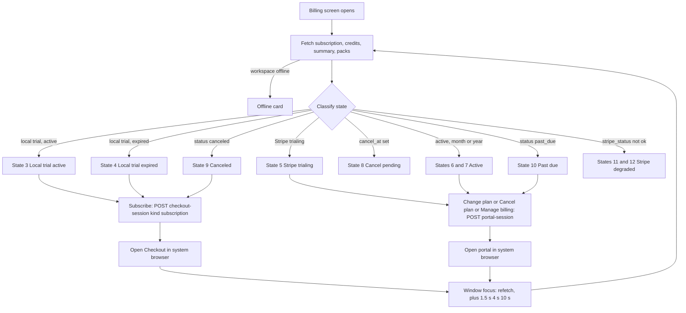

# Billing screen — Wireflow (SOLUSDEV-236)

**Status: APPROVED — 2026-10-19, in-chat (SOLUSDEV-236).** The `PROPOSED`
markers below were accepted as written, including the defaults in §Open
questions; see §Decisions for the answers. Authority for the locked parts:
ADR-023, the ADR-024 trial-expiry amendment, and the SOLUSDEV-236 in-chat
approvals.

Authority: ADR-023 (plans, prices), ADR-024 (credits, 14-day trial, trial expiry),
ADR-032 (tier-1 doc). API contracts: `docs/api/API-implementation.md` §10 and
`docs/api/API.md` §2.14. Schema: `docs/schemas/subscriptions.md`. Current
implementation this replaces in part: `apps/desktop/src/renderer/src/features/billing/`
(`BillingScreen.tsx`, `useBillingData.ts`).

Rail destination: **Billing** (existing rail page). The screen is one column,
`max-width` 820 px, scrolling. No new rail entry.

## Screen layout

```
Billing
Your plan, credits, and payment — managed securely through Stripe.

[ state banner — 0 or 1 (see States) ]          role=alert | role=status
[ cancel bar — only when cancel_at is set ]     role=status (existing copy)

┌ Current plan card ─────────────────────────────────────────────────┐
│ You're on the                                    [Manage billing]  │
│ Basic plan  · STATUS                                               │
│ ─────────────────────────────────────────────────────────────────  │
│ Trial ends      in 9 days                    (trial states only)   │
│ Renews          October 19, 2026             (active states)       │
│ Next charge     $25.00 on October 19, 2026   (or "None" / "—")     │
│ Card            Visa •••• 4242               (or "No card on file")│
│ Credits         9,059                                              │
│ Seats           1                                                  │
│ [Change plan]  [Cancel plan]                 (Stripe-backed only)  │
└────────────────────────────────────────────────────────────────────┘

Plans                                              [ Monthly | Yearly ]
┌ Basic ────────┐ ┌ Pro ──────────┐ ┌ Enterprise ───────┐
│ tagline       │ │ tagline       │ │ tagline           │
│ $25 / month   │ │ $35 / month   │ │ Custom            │
│ features      │ │ features      │ │ features          │
│ limits        │ │ limits        │ │ limits            │
│ [action]      │ │ [action]      │ │ [Contact sales]   │
└───────────────┘ └───────────────┘ └───────────────────┘

Buy credits                                           (packs section)
┌ $10 ┐ ┌ $25 ┐ ┌ $50 ┐ ┌ $100 ┐      or notice: "Credit packs aren't available right now."
```

Element rules:

- **Current-plan card.** Header line reads "You're on the", then `planLabel` +
  "plan" and a mono status chip (`statusLabel`). Right-aligned `Manage billing`
  (ghost). Rows: Trial/renewal line, Next charge, Card, Credits, Seats. Card row
  comes from `payment_method` (brand + last4 only). Credits come from
  `GET /users/me/credits`, seats from `GET /users/me/subscription` (`seat_count`,
  default 1). `unlimited` (development allowlist) keeps the existing
  "Unlimited (development)" copy (see `development-credits.md`).
- **Card actions.** `Manage billing` opens the portal with no body (general
  portal). `Change plan` opens the portal with `flow: "update"`. `Cancel plan`
  opens the portal with `flow: "cancel"`. `Change plan` and `Cancel plan` are shown
  only for Stripe-backed live subscriptions (`stripe_subscription_id` set and
  status `active`, `trialing` or `past_due`) and never while `cancel_at` is set.
- **Interval toggle.** Segmented `Monthly | Yearly` (existing `IntervalToggle`).
  Default = the current `billing_interval` when set, else `month`. Changing it only
  changes which price is shown and which Checkout interval is requested. It does
  not change the current subscription.
- **Plan cards.** Price comes from `summary.prices` for the selected interval
  (`$N / month` or `$N / year`). Enterprise has no price: "Custom". Features and
  limits are the existing `PLAN_CARDS` static copy (kept in step with ADR-023;
  the static copy is the only price-like text that does not come from the
  server, and it is limited to features and limit rows).
- **"Current plan" badge.** Shown only when `sub.plan === card.plan` AND the
  selected toggle interval equals `sub.billing_interval` AND the subscription is
  not `canceled`. Changed from today's plan-only rule (`PROPOSED` — the interval
  rule is locked by the SOLUSDEV-236 approval; the rule is restated here for the
  UI). Enterprise never shows the badge.
- **Buy credits packs.** From `GET /billing/packs`. `usd` is display-only; the
  charge is the Stripe Price. Each pack button opens Checkout in `kind: "pack"`.
- **Return from portal or Checkout.** The browser tab is outside Solus. The portal return URL is a web URL (`stripe_billing_portal_return_url`), not a desktop deep link, so the app cannot receive it directly. The
  window `focus` event refetches `summary`, `subscription` and `credits`. After a
  Checkout or portal open, also refetch at 1.5 s, 4 s and 10 s (existing
  `POST_CHECKOUT_REFRESH_DELAYS_MS`), because the webhook lands moments later.
  No separate "returned" screen exists.

## Data sources

| Source                              | Used for                                                                                                                                   | Stripe calls                                                |
| ----------------------------------- | ------------------------------------------------------------------------------------------------------------------------------------------ | ----------------------------------------------------------- |
| `GET /api/v1/users/me/subscription` | plan, status, `expires_at`, `cancel_at`, `billing_interval`, `current_period_end`, `trial_expired`, `seat_count`, `stripe_subscription_id` | none                                                        |
| `GET /api/v1/users/me/credits`      | credit balance                                                                                                                             | none                                                        |
| `GET /api/v1/billing/summary`       | trial state, next invoice, payment method, prices, packs flag, `stripe_status`                                                             | per-user calls, cached 60 s; prices cached globally ~10 min |
| `GET /api/v1/billing/packs`         | pack list                                                                                                                                  | none (config)                                               |

`GET /billing/summary` is the only source for Stripe-derived fields. A local
trial needs no per-user Stripe call. See the open question in §Open questions
about plan prices for a local trial.

## States

Classification order (first match wins): offline, loading, then the summary and
subscription fields below. `Trial` state comes from `summary.trial.state`.

| #   | State               | Detection                                                                   | Banner                                                                                               | Current-plan card                                                                                                                                                                      | Plan-card actions                                                                                                                                            | Packs                                                                                                                  |
| --- | ------------------- | --------------------------------------------------------------------------- | ---------------------------------------------------------------------------------------------------- | -------------------------------------------------------------------------------------------------------------------------------------------------------------------------------------- | ------------------------------------------------------------------------------------------------------------------------------------------------------------ | ---------------------------------------------------------------------------------------------------------------------- |
| 1   | Loading             | summary or subscription not yet fetched                                     | none (spinner, `data-testid="billing-loading"`)                                                      | —                                                                                                                                                                                      | —                                                                                                                                                            | —                                                                                                                      |
| 2   | Offline             | workspace offline (`useOfflineReason`)                                      | none; `BillingOffline` card replaces the page body (existing copy)                                   | —                                                                                                                                                                                      | —                                                                                                                                                            | —                                                                                                                      |
| 3   | Local trial active  | `stripe_subscription_id` null, `status` trialing, `trial.state` active      | none. Info line in the card                                                                          | `Basic plan · TRIALING`; row `Trial ends` = "in N days" (or "today"); Next charge "—"; Card "No card on file"; no Change/Cancel buttons                                                | Basic and Pro: **Subscribe** (Checkout). Enterprise: **Contact sales**                                                                                       | visible, enabled                                                                                                       |
| 4   | Local trial expired | `stripe_subscription_id` null, `trial.state` expired (`trial_expired` true) | **warn**, role=status: "Trial ended {date} — choose a plan"                                          | `Basic plan · TRIALING` plus a "Trial ended" row in place of "Trial ends"; Next charge "—"; Card "No card on file"                                                                     | Same as state 3. Metered (model) features blocked; everything else works (ADR-024)                                                                           | visible, enabled                                                                                                       |
| 5   | Stripe trialing     | `stripe_subscription_id` set, status trialing                               | none (info line only)                                                                                | Row "Trial ends" + "Then {amount} on {date}" from `next_invoice` (or "—" if null); Card from `payment_method`; Change/Cancel shown                                                     | Other plans: **Change plan** (portal, `update`). Current plan + interval: badge                                                                              | visible, enabled                                                                                                       |
| 6   | Active, monthly     | status active, `billing_interval` month, `cancel_at` null                   | none                                                                                                 | `Renews {date}` (from `current_period_end`); Next charge `{amount} on {date}`; Card; Change/Cancel shown                                                                               | Other plans and the yearly price: **Change plan** (portal). Current plan + monthly: badge                                                                    | visible, enabled                                                                                                       |
| 7   | Active, yearly      | as 6, `billing_interval` year                                               | none                                                                                                 | as 6                                                                                                                                                                                   | as 6, mirrored for monthly                                                                                                                                   | visible, enabled                                                                                                       |
| 8   | Cancel pending      | `cancel_at` set, status active or trialing                                  | cancel bar (existing copy, always visible while set)                                                 | Row "Ends {date}" replaces Renews; Next charge "None — plan ends {date}"; Change plan hidden; Cancel plan replaced by the text "Resume in Manage billing"                              | Cards disabled with note "Resume in Manage billing to change plans." Current-plan badge still shown when plan+interval match                                 | visible, enabled                                                                                                       |
| 9   | Canceled            | status canceled                                                             | none (the plan ended; the webhook already sent `subscription.ended`)                                 | "No active plan" headline, "Your plan ended {date}" (`cancel_at` cleared, so use `current_period_end` if present, else no date); Card "No card on file" or last card; no Change/Cancel | Basic and Pro: **Subscribe** (Checkout, new subscription). Enterprise: **Contact sales**. No current-plan badge                                              | visible, enabled                                                                                                       |
| 10  | Past due            | status past_due                                                             | **warn**: "Payment failed — update your payment method in Manage billing to keep your plan."         | Status chip `PAST DUE`; Next charge "—"; Card shows last card; Change/Cancel shown                                                                                                     | Other plans: **Change plan** (portal, `update`). Badge rule as state 6                                                                                       | visible, enabled                                                                                                       |
| 11  | Stripe unavailable  | `summary.stripe_status` unavailable (Stripe call errored or timed out)      | **warn**: "Billing is temporarily unavailable — your plan is unchanged. Try again in a few minutes." | Local fields still shown (plan, status, interval, trial and renewal dates from the subscription row). Next charge and Card show "Unavailable right now"                                | Price text "—" on every card. All purchase actions disabled (Subscribe, Change plan, Cancel plan, Manage billing, pack buttons). Contact sales stays enabled | packs listed; purchase disabled                                                                                        |
| 12  | Stripe unconfigured | `summary.stripe_status` unconfigured                                        | **info** (dev/staging only): "Billing isn't configured for this environment."                        | Same as 11                                                                                                                                                                             | Same as 11                                                                                                                                                   | packs listed; purchase disabled                                                                                        |
| 13  | Packs unavailable   | `summary.packs_available` false (`SOLUS_STRIPE_PACK_CREDITS` empty)         | none                                                                                                 | unchanged                                                                                                                                                                              | unchanged                                                                                                                                                    | **explicit notice** in the Buy credits section: "Credit packs aren't available right now." The section is never hidden |

States 3 through 10 are not mutually exclusive with the packs states; the packs
section is independent of the plan state. States 11 and 12 override the plan-card
action column for all cards.

Notes per state:

- **State 3 vs 5.** A local trial has no Stripe subscription, so its Subscribe
  action creates a Checkout session. See §Open questions, item 1 (trial length on
  Checkout).
- **State 4 is read-time.** The expiry is evaluated on each read (no job). The
  banner appears on the next summary or subscription fetch, with no push.
- **State 9.** Limits are clamped to BASIC by the webhook. The page does not show
  limits as a live entitlement in this state; plan cards carry the limits text.
- **State 10.** Dunning entitlement is not specified (see §Open questions, item 5).

## Flow



Trial expiry, cancel and webhook convergence are server-side. The page only
re-reads. A webhook may land after the user has returned, so the refetch
schedule is required, not optional.

## Actions and their API calls

| UI action                     | Call                                             | Body                                                                   | Success                    | Failure copy                                                                                |
| ----------------------------- | ------------------------------------------------ | ---------------------------------------------------------------------- | -------------------------- | ------------------------------------------------------------------------------------------- |
| Subscribe (plan card)         | `POST /api/v1/billing/checkout-session`          | `{"kind":"subscription","plan":"basic\|pro","interval":"month\|year"}` | open URL in system browser | "Couldn't open checkout — try again." (502/503 mapped to state 11 copy)                     |
| Buy pack                      | `POST /api/v1/billing/checkout-session`          | `{"kind":"pack","price_id":"..."}`                                     | open URL                   | as above                                                                                    |
| Manage billing                | `POST /api/v1/billing/portal-session`            | none                                                                   | open URL                   | "Couldn't open billing — try again."                                                        |
| Change plan / switch interval | `POST /api/v1/billing/portal-session`            | `{"flow":"update"}`                                                    | open URL                   | "This plan can't be changed right now — use Manage billing." (409 `no_active_subscription`) |
| Cancel plan                   | `POST /api/v1/billing/portal-session`            | `{"flow":"cancel"}`                                                    | open URL                   | "Your plan is already scheduled to end." (409 `cancel_already_scheduled`), then refetch     |
| Contact sales                 | none (Electron main IPC `billing:contact-sales`) | none                                                                   | opens hardcoded `mailto:`  | none (OS mail client handles failure)                                                       |

409 `no_billing_customer` on Manage billing means the user never checked out. Show
the state 3 or 9 copy for Subscribe, not an error.

## Contact sales (Enterprise)

- Button label: **Contact sales** (secondary button, `Button kind="soft"` size sm).
- Default: `--mut` text, `--bd` border.
- Hover: `--acc` border, `--fg` text, underline. Focus-visible ring uses the
  standard `--acc` ring.
- Click: `window.solus.billing.contactSales()` → preload → main-process IPC
  `billing:contact-sales`. The main process opens the hardcoded address
  `mailto:team@solusforge.com?subject=Enterprise%20plan`. The renderer passes no
  URL and no subject (the URL is never from renderer input).
- Replaces today's `mailto:sales@solus.dev` anchor, which never opened (the
  https-only external-URL guard drops it) and had the wrong address.
- No data-collection event for the click in this slice (see §Events).

## Copy (user-facing strings)

Billing copy is product UI, not agent output. It does not vary by SOL mode.
(`PROPOSED`: confirm with a human. Any SOL-generated text on a blocked request
must follow SOL mode, see the table at the end.)

| Key                             | Copy                                                                                                               |
| ------------------------------- | ------------------------------------------------------------------------------------------------------------------ |
| Header subtitle                 | Your plan, credits, and payment — managed securely through Stripe.                                                 |
| Offline (API unreachable)       | You're signed in, but Solus can't reach its API — your plan and limits will appear here once it's back.            |
| Offline (signed out)            | Sign in to Solus to manage billing — your plan, trial, and limits live here.                                       |
| Trial active (card row)         | Trial ends in {N} days / Trial ends today                                                                          |
| Trial expired (banner)          | Trial ended {date} — choose a plan                                                                                 |
| Trial expired (card row)        | Trial ended {date}                                                                                                 |
| Stripe trial (row)              | Trial ends {date}, then {amount} on {date}                                                                         |
| Renewal (row)                   | Renews {date}                                                                                                      |
| Next charge (row)               | {amount} on {date}                                                                                                 |
| Next charge none                | None — plan ends {date} (cancel pending) / — (other states)                                                        |
| Card none                       | No card on file                                                                                                    |
| Card                            | {Brand} •••• {last4}                                                                                               |
| Canceled (card headline)        | No active plan                                                                                                     |
| Canceled (row)                  | Your plan ended {date}                                                                                             |
| Cancel bar (existing)           | Your {Plan} plan ends on {date} — you keep full access until then. Changed your mind? Resume it in Manage billing. |
| Past due (banner)               | Payment failed — update your payment method in Manage billing to keep your plan.                                   |
| Stripe unavailable (banner)     | Billing is temporarily unavailable — your plan is unchanged. Try again in a few minutes.                           |
| Stripe unavailable (row)        | Unavailable right now                                                                                              |
| Stripe unconfigured (banner)    | Billing isn't configured for this environment.                                                                     |
| Packs unavailable               | Credit packs aren't available right now.                                                                           |
| Cards disabled (cancel pending) | Resume in Manage billing to change plans.                                                                          |
| Checkout success (existing)     | Payment received — your plan and credits are updating now.                                                         |
| Checkout canceled (existing)    | Checkout canceled — you haven't been charged.                                                                      |
| Current plan badge              | CURRENT PLAN                                                                                                       |
| Subscribe button                | Subscribe · Monthly / Subscribe · Yearly                                                                           |
| Switch button (Stripe-backed)   | Change plan                                                                                                        |
| Enterprise action               | Contact sales                                                                                                      |
| Enterprise features (existing)  | Per-seat pricing, set per agreement / Billed to your organization's wallet — one subscription covers every seat    |

### SOL block message (trial expired), SOL mode aware

This is agent-facing text shown in SOL when a model-backed request is refused with
`trial_expired` (see `API-implementation.md` §10). The mode is read from
`settingsStore.solMode` (ADR-016).

- **Guide:** "Your free trial ended on {date}, so model features like SOL's answers are paused. Your projects, data and integrations still work. Choose a plan under Billing to turn model features back on."
- **Expert:** "Trial ended {date}. Model features paused — choose a plan in Billing."

Both variants carry a single action: open the Billing page.

## Events (data collection, ADR-011)

| Event                                                                        | When                                         | Source                |
| ---------------------------------------------------------------------------- | -------------------------------------------- | --------------------- |
| `billing.checkout_session.created`                                           | Checkout opened (existing)                   | server                |
| `billing.portal_session.created` `{flow: "general" \| "update" \| "cancel"}` | portal opened                                | server (SOLUSDEV-236) |
| `orchestration.blocked` `{reason: "trial_expired"}`                          | model call refused on an expired local trial | server                |
| `billing.subscription.reconciled`                                            | reconciliation cron changed a row            | server                |

`PROPOSED` (not in this slice): a `billing.contact_sales.clicked` event, which
requires adding to the closed `event_type` set in `POST /api/v1/events`.

## Accessibility

- Banners use `role="alert"` for warn-level states (past due, Stripe unavailable,
  trial expired) and `role="status"` for info-level states (cancel bar, local
  trial info).
- The interval toggle is a `role="group"` with `aria-pressed` buttons (existing).
- Disabled purchase actions keep a visible label; the reason is in the banner
  above, not in a tooltip.
- Reduced motion: no animation is added by this screen.

## Decisions (2026-10-19, in-chat)

1. **Trial carries over to Checkout.** A subscription Checkout started during a
   live local trial sets the Stripe `trial_end` to the local `expires_at`, so the
   whole trial is one 14-day period. An expired local trial gets no Stripe trial.
2. **Plan prices** come from Stripe Prices through one global cache (~10 min),
   shared by all users. "A local trial makes no Stripe calls" means no
   per-user calls.
3. **Proration:** one portal configuration (see item 3 below).
4. **Monthly ↔ yearly** for a Stripe-backed plan goes through the portal
   (`flow: "update"`).
5. **Dunning (`past_due`)** keeps today's behaviour: plan limits stay and
   existing credits stay spendable, with the past-due banner. Stripe cancels
   after its retries fail, and the webhook then clamps the plan to Basic.
6. **Degraded prices** show "—", never the static numbers.
7. **Sales address:** `team@solusforge.com`.
8. **No Contact sales click event** this round.

## Open questions (answered — kept for the record)

1. **Trial length on Checkout (blocking for state 3).** `create_checkout_session`
   always applies `stripe_trial_days` (14) as `trial_period_days`, even when a
   local trial is live with days left. Options: (a) keep the fresh 14-day Stripe
   trial (generous; users can subscribe during the trial and get 28 days);
   (b) set `trial_end` to the local `expires_at` so the remaining local days carry
   over (`PROPOSED` recommendation: b, so the trial is one 14-day period).
2. **Plan prices for a local trial.** Prices are a global cached lookup, so a cold
   cache calls Stripe Prices for a user with no Stripe link. The locked text says a
   local trial makes no Stripe calls. Recommendation: read the `amount_cents`
   values from Stripe Prices (global, cached), and count only per-user calls
   against "no Stripe calls". Confirm.
3. ~~Downgrades at period end.~~ **Resolved (orchestrator, verified against the
   installed Stripe SDK):** one portal configuration expresses both rules.
   `subscription_update.proration_behavior = "always_invoice"` charges upgrades
   now, and `subscription_update.schedule_at_period_end.conditions =
[decreasing_item_amount, shortening_interval]` defers downgrades to renewal.
4. **Interval toggle on Stripe-backed plans.** This wireflow routes a monthly to
   yearly switch through the portal (`flow: "update"`). Confirm.
5. **Dunning entitlement.** `past_due` is not in the live statuses that grant
   plan credits (`plan_grants.LIVE_STATUSES`). ADR-023 does not say whether limits
   stay on during dunning. The wireflow shows the banner only.
6. **Degraded prices.** In states 11 and 12 this doc blanks prices to "—" rather
   than showing the static `PLAN_CARDS` numbers. Confirm (the static numbers could
   mislead if Stripe prices differ).
7. ~~Sales address.~~ **Resolved (SOLUSDEV-236 Phase 1):** `team@solusforge.com`.
8. **Contact-sales event.** Whether to add `billing.contact_sales.clicked` (see
   §Events).

## Related

- `docs/wireflows/development-credits.md` — the unlimited (development) display.
- `docs/wireflows/home.md` — Home surfaces that link to Billing.
- `docs/api/API-implementation.md` §10 — endpoints, state derivation, trial expiry.
- `docs/schemas/subscriptions.md` — columns and writers.
